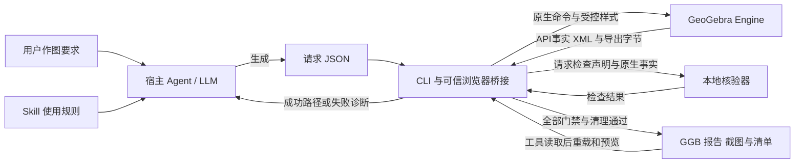

# 架构：Agent、插件工具与 GeoGebra

核心分工是：**LLM 组织请求，工具控制执行与验收，GeoGebra Engine 解释数学。**
本文只讲组件关系和关键数据；字段与门禁以[CLI 契约](demo-contract.md)为准，
逐阶段代码走读见[三角形案例执行说明](triangle-execution-walkthrough.md)。
模块内部算法、输入输出、资源归属与失败边界见[详细设计](details-design.md)。

## 架构与责任



| 部件 | 做什么 | 不承担什么 |
| --- | --- | --- |
| Agent / LLM | 理解原文、区分条件与演示选择、编写请求、读诊断并决定修复 | 不能凭生成文字授予核验通过 |
| [Skill](../skills/ggb-demo-construction/SKILL.md) | 告诉 Agent 怎样编写请求、调用工具、阅读报告和处理失败 | Markdown 规则本身不执行数学或调用模型 |
| [CLI](../src/cli.ts) 与 [pipeline](../src/pipeline.ts) | 检查输入，管理浏览器，构造、核验、导出、重载、清理和交付 | 不从题目关键词选择固定构图配方，不内置 LLM 客户端 |
| [可信桥接](../viewer/engine.js) | 将已预检请求转成 GeoGebra API 调用，采集原生事实 | 不执行请求携带的任意 JavaScript |
| GeoGebra Engine | 解释原生命令，建立对象和动态依赖，计算关系，序列化构造 | 不知道用户原文是否已完整提取，也不决定正式 delivery 是否提交 |
| [核验器](../src/verify.ts) | 将声明的检查与实际事实比较，产生逐项结果 | 不生成数学事实，不把截图相似当作关系成立 |

宿主与插件的连接点是请求和工具结果。推理沿用宿主；本地插件提供 Skill、CLI、
桥接和运行时准备机制，不新增模型服务或 API Key。构图与核验使用固定官方运行时，
身份见[runtime.lock.json](../runtime.lock.json)与[runtime.ts](../src/runtime.ts)。

## LLM 的输出怎样进入 Engine

以三角形中点为例，Agent 输出的是包含原题、选择、程序、检查、样式和输出声明的
JSON。下面只是关键字段节选，不是完整可运行请求：

```json
{
  "program": [
    {"label": "M", "expression": "Midpoint(A,B)"},
    {"label": "CM", "expression": "Segment(C,M)"}
  ],
  "checks": [
    {"id": "midpoint", "requirement": "geometry", "kind": "object",
     "label": "M", "type": "point", "parents": ["A", "B"]},
    {"id": "midpointRelation", "requirement": "geometry", "kind": "boolean",
     "expression": "AreEqual(M,Midpoint(A,B))"}
  ]
}
```

实际请求还须先构造 A、B、C 等对象，并声明其他必填字段。
完整形状见[请求 schema](../schemas/request.schema.json)；
[triangle.json](../examples/triangle.json)同时包含颜色、点名与拖动扩展。
初始坐标属于 choices，不是用户给定条件。

[request.ts](../src/request.ts)把模型输出当作不可信输入，检查结构、引用、容量、
声明覆盖和副作用边界。通过预检后，[runRequest](../viewer/engine.js#L113)将
label 和 expression 组合成 `M=Midpoint(A,B)`，再调用原生 evalCommand。
**中点的数学含义由 Engine 解析，不由 LLM 或 TypeScript 重新实现。**

颜色与点名通过固定 setColor、setLabelVisible、setLabelStyle API 应用。
请求不因此获得任意 Set* 或脚本执行能力；原生命令失败仍会阻止交付。

## XML、GGB 和 script 各是什么

| 名称 | 当前工程中的作用 | 与 LLM、Engine 的关系 |
| --- | --- | --- |
| 构图 XML | getXML 返回构造序列化；getAlgorithmXML 返回算法结构。桥接从算法输入读取 parents，并保存 XML 供诊断 | 来自 Engine，不由 LLM 手写成成功证据 |
| 原生事实 JSON | snapshot 汇总类型、定义状态、独立性、坐标、颜色、标签及算法父对象 | API 与 XML 观测值经可信桥接整理，供核验器比较 |
| GGB | Engine 原生导出的 ZIP 格式构造包，包含 geogebra.xml 等条目，可保存对象、依赖和显示状态 | 由 getBase64 导出、工具写盘，再用 setBase64 加载；不是把 XML 改扩展名 |
| 核验报告 | 保存期望、实际事实、逐项状态、要求汇总与适用交互证据 | 工具根据事实生成；不是 LLM 输出的一段 passed 文本 |

数据采集见[snapshot](../viewer/engine.js#L31)，导出和加载见
[exportGgb / loadDiskGgb](../viewer/engine.js#L86)。核验器并不直接“验证全部 XML”：
它消费 API 和解析所得事实；完整 XML 另行保留，GGB 内容另行审计。

这里的 **script** 需要区分三种含义：

- 请求的 program 是原生命令序列，如 Midpoint、Segment，不是 JavaScript。
- viewer/engine.js 是项目提供的可信 JavaScript，用于连接 CLI 与 Engine；模型不能替换它。
- GGB 内还可能有 JavaScript 或 GGBScript。[auditGgb](../src/delivery.ts#L46)
  会拒绝自定义脚本、宏和不支持资源；只允许官方默认空初始化函数等当前安全子集。
  原生布尔探针是构造对象，不是用来绕过边界的嵌入脚本。

## 如何通过 verifyChecks

CLI 把两类输入交给 [verifyChecks](../src/verify.ts#L63)：请求中的 checks 和当前
Engine 的 facts。它返回逐项结果数组，不是一个总的成功布尔值。

| 检查 | 核验器读取什么 | 三角形中的意义 |
| --- | --- | --- |
| object | 始终检查存在、已定义；按声明进一步比较 type、parents / independent 和 coordinates | M 必须为 point，依赖 A、B；CM 必须依赖 C、M |
| boolean | 按原检查索引读取 ggbCheck 探针，要求已定义、类型 boolean、数值真值 1 | AreEqual(M,Midpoint(A,B)) 由 Engine 计算，numeric 的 1 不能冒充 |

例如，静态 `M=(3,0)` 可能恰好位于 AB 中点，但 parents=[]、independent=true，
无法满足父对象为 A、B 的声明。坐标相同并不等于原生依赖正确。
布尔探针由桥接创建，会随 GGB 导出，重载后核对原探针而非重新构造替代。

各层“通过”的意义不同：

- **check：** 只做输入预检，不启动 Engine；数学为 not-evaluated。
- **verifyChecks：** 当前实际检查的对象与布尔条件通过；可按 ids 选子集，交互阶段
  可剥离初态坐标，所以不能把局部通过扩大为全部条件通过。
- **verifyRequest：** 加上 verifyStyles、全量对象存在与定义状态、支持类型检查。
  颜色和点名在这里通过样式检查汇总，不在 verifyChecks 内判断。
- **build：** 整条执行、重载、适用交互、资源关闭和文件提交全部通过，才正式交付。

请求的检查清单也由 Agent 编写，因此还须对照原题审核是否漏条件。
上述检查均不等于一般数学证明。详细对照见
[走读文档第 6.4 节](triangle-execution-walkthrough.md#64-checkverifychecks-与-build-的通过不是同一层级)。

## 主要流程

1. Agent 按 Skill 保存完整请求；CLI 执行 check 或 build 的输入预检。
2. build 启动本次专用浏览器与空 applet，执行原生命令、探针和样式，采集并核验初态。
3. 初态通过后原生导出 GGB；关闭旧上下文，在新空 applet 中读取磁盘文件并复核。
   请求含拖动时，每个样本再次独立加载，用真实鼠标检查位移、依赖、关系和样式。
4. 资源关闭后写清单并复核完整目录，最后重命名暂存区提交正式 delivery。
   中间报告 passed、已有截图或 GGB，都不能替代最终提交。
5. Agent 复核原文覆盖和报告，再调用 preview。preview 先 headless 复核，再在可见
   applet 加载同一份 GGB 字节，不执行 program 重画。ready 表示可交互；closed、
   退出 0 和清理记录表示正常退出。预览失败单独报告，不改写原交付。

**宣称文件交付成功的条件：build 最终退出 0，成功响应返回本次正式 delivery 路径，
且 Agent 已核对请求与报告覆盖原题要求。** 必需条件失败或未验证时不得交付。
具体提交逻辑见[pipeline](../src/pipeline.ts)，完整性复核见[delivery](../src/delivery.ts)，
同文件展示见[preview](../src/preview.ts)。

## Agent 接收失败后的修复流程

核验失败后，CLI 保存可取得的诊断并清理退出，不自行调用 LLM。
Agent 读取 expected / actual 和错误原因，按
[Skill 失败规则](../skills/ggb-demo-construction/SKILL.md#failure-and-repair-limit)
决定是否使用宿主推理修改请求。初次 build 之外，最多允许两次自动修复；不是每次
失败都必须尝试。每次另存请求，check 通过后开启新 build，保留旧证据。

可以把静态 M 修正为 Midpoint(A,B)，不能删除依赖检查或放宽容差。
不可修复、无法核验或达到上限时，报告阻碍并停止。CLI 没有持久化修复计数器；
宿主实际是否走完这个循环，要有相应运行记录，不能由规则存在推导。

## 配套实现与验证边界

Codex 本地打包、setup、系统 Chrome/Edge 选择与安装隔离见
[安装契约](codex-installation.md)；固定回归见[技术实验](technical-experiment.md)。
当前实际验证状态统一查[验收记录](acceptance.md)，不要从设计图推导宿主 UI、
模型驱动首题、双宿主、完整独立安装、强制取消或公开发布已完成。
本页 Mermaid 仅静态核对，未做渲染验收。
