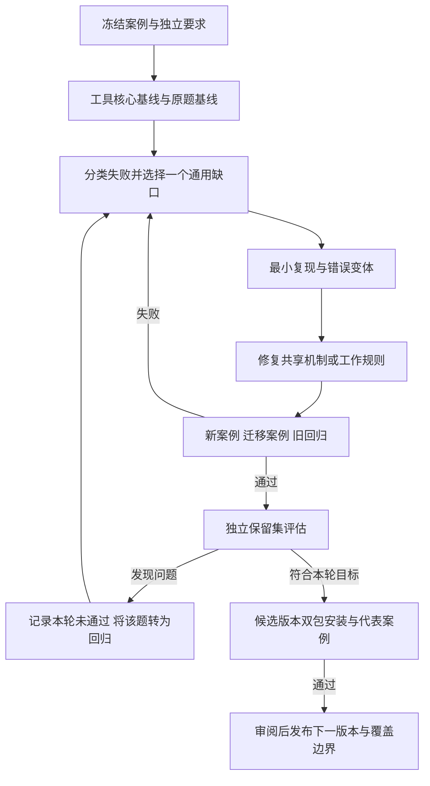

# 首轮发布后提升二维数学能力的开发与录屏脚本

第一轮三角形中线案例只证明一条端到端路径：题目、构图、核验、安装与发布能够连接起来。它不能证明一般二维数学能力，也不能单凭一次通过宣称稳定。

本篇接在 [第一轮录屏脚本](recording-script.md) 第 09 段之后。第二轮以跨域案例设计、错误发现、通用修复和独立评估为主线，新增约 20 分钟录屏。第一轮约 28 分钟保留为基础篇，两篇合计约 48 分钟，也可以分两集发布。

这是待执行方案。本文中的案例数量、工具和指标都不是当前教学版的实测结果；不执行代码修改、数学实验、模型评测、安装或发布。规范范围、验收门禁和 CLI/请求契约分别以 [requirements.md](requirements.md) 和 [demo-contract.md](demo-contract.md) 为准；本文件只描述后续计划，不复制当前契约或实测结论。

## 1 本轮要回答的问题

通用性是指：新问题通过原生命令、声明检查和交互样本进入同一套执行机制，而不要求为每道题添加专用生产分支。可靠性是指：在明确的输入范围、引擎和宿主版本下，有可复现的成功与拒绝证据。

GeoGebra 拥有广泛原生数学能力，不等于插件已经能完整采集事实、核验依赖、处理多输出和重载，也不等于 Agent 能正确提取任何题目的全部条件。这些边界要分开验证。

| 层次 | 要验证的问题 | 主要证据 |
| --- | --- | --- |
| 原生引擎 | 这条语句在固定运行时产生什么对象？ | 最小 applet 实验、实际类型和输出 |
| 执行与核验核心 | 请求是否正确执行、独立重载并维持条件？ | 冻结 JSON 请求与真实浏览器回归 |
| Agent 与 Skill | 从未见过的题目能否提取条件并编写正确请求？ | 新会话原题、生成请求、独立要求表 |
| 安装与宿主 | 安装包是否齐全，两端行为是否一致？ | 包身份、隔离安装和代表性案例 |

“命令被接受”“对象被创建”“条件被核验”“独立重载”“交互成立”“原题条件完整”是不同结论。覆盖表按这些证据分别记录。

## 2 如何设计一组有辨别力的例子

### 2.1 用能力与风险选题

先列数学任务，再寻找执行和核验风险。不要只换三角形的坐标，也不要把刷题数量当成能力覆盖。

| 维度 | 需要覆盖的差异 |
| --- | --- |
| 数学对象 | 点线圆、圆锥曲线、函数、不等式、代数结果、列表矩阵 |
| 输出形态 | 单对象、多输出、自动标签、嵌套列表、数值、布尔与未定义 |
| 依赖关系 | 自由点、受约束点、滑块、传递依赖、可变长度对象 |
| 定义域和分支 | 重根、无实解、分母为零、退化构型、条件性符号结论 |
| 交互 | 真实鼠标、参数赋值、增长后缩小、恢复初态 |
| 表达方式 | 中文、英文、重命名、等价表述与不同对象创建顺序 |
| 生命周期 | 初态、磁盘导出、独立重载、交互副本、最终预览 |

这些维度交叉组合，不要求笛卡尔积全覆盖。先选择会暴露不同缺陷的代表输入，后续由真实失败补齐组合。

### 2.2 每个案例族至少四种输入

1. 正例 P：数学条件明确，可以正确构造与核验。
2. 错误变体 N：只改一个关键关系或期望，保留其他要求，用来检查门禁能否发现错误。
3. 有效变化 V：改变构型、参数、名称或表达方式，数学关系仍应成立。
4. 边界 B：命中退化、未定义或证据不足。预先写出应拒绝、需澄清、限制定义域或可继续的具体政策。

P 与 V 成功不代表 N、B 一定会被正确处理。N 被拒绝也要记录阶段：格式预检、原生执行、独立条件核验或交互。只因拼错标签而拒绝，不能算已证明数学核验有效。

### 2.3 拟定的首批能力矩阵

以下 12 族各设计 P/N/V/B，共 48 个开发输入。这是教学预算，不是“48 题通过即可覆盖二维数学”的阈值。每族的期望要经录制者审核，再冻结；尚不支持的能力记录缺口，不伪装成已验收。

| ID | 正例与独立期望 | 错误变体 | 有效变化与边界 |
| --- | --- | --- | --- |
| G1 中点依赖 | 三角形中线；中点共线且两段相等，线段端点与依赖正确 | M 写成初态中点坐标独立点 | 旋转或换非对称顶点；共线顶点不能作为非退化三角形交付 |
| G2 圆与交点 | 三个不共线点确定圆；三点到圆心等距且属于该圆 | 给定错误圆心或漏掉一个必需交点 | 改点名与坐标；三点共线应明确拒绝或澄清 |
| G3 切线分支 | 圆外点 P 的两条切线；接触点在圆上，半径垂直切线，切线过 P | 过 P 的割线冒充切线 | 圆外点换象限；P 在圆上或圆内，按题意“需要两条”处理数量变化 |
| G4 变换关系 | 点关于直线反射；中点在镜面、连线垂直且两侧距离相等 | 只在初态写死反射点坐标 | 平移、旋转整套构型；原点落在镜面上是合法固定点，不能误拒绝 |
| G5 路径约束 | 点在圆或曲线上移动；检查约束与下游对象联动 | 同坐标自由点冒充路径点 | 换起始位置、点名；目标遮挡或未移动属于交互证据不足 |
| G6 动态多边形 | 正 n 边形内接圆；顶点数、所有顶点在圆上、等边、面积关系 | 只按初始 n 创建固定顶点列表 | n=3→8→4→3；非法 n 或缺失收缩恢复证据必须准确处理 |
| C1 椭圆多输出 | 半轴 a>b>0；两个焦点满足焦距平方=a²-b²、位于主轴且为相反点 | 漏一个焦点、误认命令返回的多输出为单点 | 改名、改变 a；a=b 成圆时按已声明对象与焦点政策处理，不自行豁免 |
| F1 函数与微积分 | f(x)=a*x²，导数满足 2ax，0 到 1 积分为 a/3 | 导数或积分固定成初始 a 的结果 | a 取多个值；允许 a=0 时须检查零函数，不能沿用非零专用判断 |
| F2 定义域 | f(x)=(x²-1)/(x-1) 与 x+1 在 x≠1 比较 | 化简后错误宣称 x=1 也有原函数值 | 取负值与非整数；x=1 要记录未定义或排除，不能按化简扩域 |
| A1 方程分支 | x²-k=0；根代回原式为零，数量按 k>0、k=0、k<0 的实数域约定 | 只返回一个根或携带不满足原式的根 | 非整数 k；实数域无解不能当引擎失败，也不能静默改为复数域 |
| D1 列表矩阵 | 独立预期表核对统计值、矩阵元素与形状，保留小数、空列表和布尔类型 | 单元素改错或把 false 当 0 | 调整合法数据、维度；奇异矩阵求逆与未定义元素遵循明示契约 |
| S1 符号条件 | 在题目给定 x>0 时核验 sqrt(x²)=x，保留条件来源 | 删除假设仍宣称全域成立 | 改符号名；无符号假设时保留 abs(x) 或未验证，不能暗加 x>0 |

这里的表达式是测试规范中的数学期望，具体 GeoGebra 语法要由固定运行时最小实验确认。不要把本表直接当作已验证命令配方。

### 2.4 检查期望不能跟着实现一起漂移

录制者或独立审阅者先确认原题到要求的映射，再让开发 Agent 写构造。为小数值案例提供手算或另一种推导得到的固定期望。通用关系也须解释为什么对应题意。

例如椭圆用 a=3、b=2 时，焦点坐标平方为 5，两个焦点关于原点对称且 y=0。只再次调用同一个 Focus 命令比较自己的输出，独立性不足。

导函数用解析式、独立选取的数值样本和依赖事实交叉检查。使用同一引擎重跑同一表达式不等于独立数学证明。对目前无可靠核验路径的要求，记录未验证并禁止完整交付。

## 3 先分离两种评估，再看改动归属

### 3.1 冻结请求评估工具核心

输入为已审核的固定 JSON，先不让模型每次重新生成。保持题意、期望、容差、运行时和样本政策不变，定位程序执行、事实采集、核验或重载的失败。

这组测试回答“正确编写的请求能否被工具可靠处理”。它不测模型提取题意的能力。

### 3.2 原题评估 Agent 与 Skill

输入只有原题及通常可见的用户资料。每个题在新会话执行，记录模型与推理设置、宿主、Skill 版本和修复次数。评分使用独立审核的要求表，不能只信模型生成的检查。

同时记录两种口径：完整题目成功率、在所有必需条件上正确判断的情况。一个有效任务被保守拒绝属于可用性失败，不会因“没有交付错误”而算作成功。

Agent 随机性存在。教学评估可对选定跨域题各做 3 次独立新会话试验，并保留所有结果；这是观察波动，不足以估计真实总体稳定率。不要只展示最成功的一次。

### 3.3 失败归因与最小修改

| 失败层 | 例子 | 首选修改位置 |
| --- | --- | --- |
| 题意理解 | 把示意图比例当条件、漏掉两条切线 | 要求提取流程、澄清与独立要求复核 |
| 请求编写 | 原生语法或 outputs 声明错误 | examples、references 或诊断；先检查真实引擎语义 |
| 输入契约 | 合法多输出或列表无法表达 | 有明确跨例需求才扩展 schema 与文档 |
| 事实采集 | 多对象只采一个、false 当 0 | 通用输出与类型采集机制 |
| 数学判定 | 只检查初态、同义反复式自证 | 通用谓词、依赖与证据完整性门禁 |
| 生命周期 | 导出后丢依赖、样本相互污染 | 独立重载、隔离样本和恢复检查 |
| 安装宿主 | 引用漏打包、CLI 指向源码目录 | 打包器、资源定位与宿主适配 |
| 引擎/范围限制 | 动态 CAS 无法提供所需证据 | 明确未支持范围或选择原生可核验构法 |

判断是否修改 Skill：这条规则是否跨多个案例成立，并且会改变 Agent 的决策？具体公式、标签、参数、命令配方留 examples/references。能确定性执行的限制放工具里。Skill 不能变成题目答案库。

## 4 第二轮迭代流程与评估契约



保留集一旦反馈用于修复，就不再算未见测试。下一次声称“未见题评估”前需要新的独立保留集，不能反复调到同一组全部通过。

### 4.1 案例与运行记录的最小契约

字段是拟议评估协议，实施前写入教学版契约，不冒充现有 CLI schema。

| 字段 | 含义 |
| --- | --- |
| caseId/family/split | 案例身份、能力族、开发/保留/历史回归归属 |
| prompt/request | 原题与冻结请求分开保存，原题评估不能拿标准请求作为提示 |
| requirements/oracleSource | 独立要求表、期望值与来源；谁审阅了这些期望 |
| expectedOutcome/stage | 应成功、拒绝、需澄清或未验证，以及预期失败阶段 |
| transforms/mutations | 有效变化规则与错误注入位置 |
| validDomain | 定义域、非退化条件、合法样本范围 |
| revision/runtime/host | 代码、Skill、模型设置、运行时、宿主、包摘要 |
| actualOutcome/reason | 真实结果、首错、是否实际完成所有必需条件 |
| attempts/duration/artifacts | 首次与修复后结果、用时及 request/report/GGB/截图路径 |

聚合报告区分“未执行、成功交付、预期拒绝、意外拒绝、错误交付、证据不足”。不要把所有非成功统称 failed，也不要把拒绝率直接当正确率。

正式 build 保留原有 passed/failed/unverified 语义；评估记录的 expectedOutcome 是外层测试预期，不改生产门禁。需澄清是宿主对话行为，不伪造为 CLI 已提供的状态。

### 4.2 基线与指标

- 正例首次成功：分母为本轮已执行且预期可完成的 P/V 输入。未执行单列；报告其数量，不能从总清单里消失。
- 受限修复后成功：与首次结果分开，固定最多两次修复；报告每次失败和成本。
- 错误交付：N/B 不满足完整要求却正式交付。任何本轮观测到的错误交付都是该范围的发布阻碍。
- 变异检出：结构合法且错误已确认的 N 中，有多少被目标门禁识别；无效变异、无实质影响变异、偶然语法失败单列。
- 有效变化一致性：V 应保持的关系是否仍成立；按物理量缩放或符号重命名规则比较，不要求无意义的字节一致。
- 旧回归变化：原有通过变失败、原有应拒绝变接受，分别记录。
- 原题要求完整性：独立要求表中遗漏、篡改、未检查的条目数；不能仅统计请求内部 checks 是否通过。
- 安装与资源：实际包身份、运行时版本、结果一致性、失败后的资源释放与证据保留。

指标是这次有限样本的观测。不要给出无来源的“二维题支持率 95%”，也不使用命令数量作为支持率分母。

## 5 如何保留未见题与防止针对测试调参

开发矩阵可以公开。保留集的具体题干、标准要求、固定请求和期望在候选版本冻结后才揭示。

建议由录制者或另一位同事准备至少四道未见组合题，覆盖几何、参数函数、跨域组合和边界处理。开发 Agent 在修复前不能读取；评估后可以公开，用作视频证据。

这里的“独立”是评估组织方式，不是同一机器上的安全隔离保证。同一个 Agent 生成、修复并评分的测试只能称自测。没有独立准备条件时，如实标注“Agent 自生成评估，存在同源偏差”，不能称盲测。

保留集不指定关键词或照搬开发例子的命令序列。例如将圆、约束点与统计组合；或把函数参数、导数和交点数量组合。具体题干由独立人员决定，不能让开发 Agent 按这份建议猜题后把它们并入训练样例。

缺陷修复的迁移案例也不必都来自保留集。先在公开开发集中选择另一个对象或数学域，检查共享机制是否真正可复用；保留集留到候选冻结后。

## 6 变形测试与错误注入的具体做法

### 6.1 有效变形

- 平移、旋转：中点、共线、垂直、等长关系应保留。变换后的期望由变换规律产生，不能重新调用同一构造函数当标准答案。
- 正比例缩放 s>0：长度乘 s，面积乘 s²。不能对面积也乘 s，必须记录维度。
- 标签重命名：合法重命名后，按身份映射比较依赖关系，不按旧字符串断言。
- 调整合法创建顺序：独立对象可以换序；依赖对象仍须遵循拓扑顺序，不把非法前向引用当合法变化。
- 参数历史：n 或 a 先增加再减少再恢复，检查元素消失、下游对象与初态恢复，不只看两个独立最终截图。
- 同题中英文：使用独立要求映射确认语义等价，再测 Agent 输出。中文和英文成功不是数学域扩展的替代物。

### 6.2 错误注入

把动态对象替换为初态坐标、漏声明一个多输出对象、修改矩阵单元、删除符号假设、把域外点混入检查、把实际 false 当 0，均可作为测试专用变异。

每个变异标记预期捕获层。至少一些变异必须格式合法、能在引擎创建对象，再由关系、重载或交互门禁识别；否则只能证明输入校验存在。

错误注入只写入测试夹具和运行器。生产代码不增加绕过核验或“强制通过”的开关。未检出的变异先审阅是否真的错误、是否在规定范围，再记录漏检，不直接增加针对该 caseId 的分支。

## 7 录屏段 11 设计能力矩阵并跑基线

**成片：第二篇 00:00–04:00。原始录制预算：1～2 小时。**

### 给 Codex 的完整提示词

```text
继续 ggb-plugin-demo 的首轮发布后开发。先读取 AGENTS.md、需求、
现有输入契约、发布/安装记录，以及 docs/capability-iteration-script.md。
检查工作目录和未提交改动。保留现有三角形案例为长期回归。

本段不修复代码、不扩展 Skill、不发布。先建立可审阅的能力测试设计。
按本文 12 个能力族设计 P 正例、N 错误变体、V 有效变化、B 边界输入，
共 48 个开发输入。区分数学域、输出类型、依赖、定义域与生命周期风险。

每个输入写出原题、独立要求、期望来源、合法范围、预期结果和失败阶段。
不从构造程序机械复制检查；不能再次调用同一构造函数作为唯一标准答案。
新数学能力尚无可靠核验路径时明确标记能力缺口，不宣称通过。

先输出 docs/capability-matrix.md 和测试设计，供我审核数学期望。
审阅前不把 Agent 自拟期望当标准答案。保留集由录制者单独准备，
你不要生成或读取它，也不要将开发矩阵称作盲测。

审核后在独立后续提示下再实现开发集运行器并运行基线。
本段最终指出哪些输入能用现有契约表达，哪些暴露通用接口或证据缺口。
```

### 审阅后运行基线的完整提示词

```text
我已审阅当前 docs/capability-matrix.md 中的开发集要求与期望，
以该文件当前版本为基线。请记录其摘要后继续；如你需要改变数学期望，
先列出差异重新审阅，不静默修改。

请实现最小案例运行器。命令建议 pnpm eval:core -- --suite development，
先在 README 声明实际语法。只使用已审核冻结请求评估工具核心，
不要在每次运行中让模型重新生成 JSON。

结构不能表达的案例记录能力缺口；超时、未执行、意外拒绝、预期拒绝、
错误交付和成功交付分开统计。保存版本、实际原始诊断与产物路径。
错误变体保留期望失败阶段，不能以任意异常冒充目标门禁检出。

运行当前版本基线，不修复实现。输出本次观测到的缺口、首次结果及
案例数量。不要声称所有二维问题稳定，不修改或发布生产 ggb-plugins。
```

### 操作与讲解

1. 展示首轮发布结果，提出“其他对象和错误情况怎么办”。
2. 输入设计提示词，逐行审阅矩阵，重点看预期拒绝与边界政策。
3. 审阅后输入基线提示词，运行 README 中实际可用的命令。
4. 打开基线报告，选择一个可复现且能迁移的失败作为下一段对象。

讲解词：

> 三角形通过，只说明这一条路径有证据。现在按对象、输出、依赖和定义域来设计案例，每族加入正例、错误输入、有效变化和边界。我们先记录当前版本实际能做到什么，再选择一个共享机制的缺口来修复。

### 必留画面

能力矩阵；人工审核前后；固定输入摘要；基线的成功、拒绝与未执行明细；真实失败原始报告。基线全部通过时，不伪造失败，直接进入更有区分力的新组合或变异测试。

## 8 录屏段 12 从失败提取通用机制

**成片：第二篇 04:00–08:00。预算：1～3 小时，按真实问题调整。**

可选择的演示主题是“多输出与类型采集”或“参数变化后的依赖与列表收缩”。它们是样板项目里已有测试的风险类型，不表示教学版必然存在同一缺陷。

### 给 Codex 的完整提示词

```text
继续 ggb-plugin-demo 第二轮开发。读取工作约定、已审核矩阵、冻结基线
和实际失败原始证据。选择刚才录制者指定的一个真实通用缺口。
如果当前未出现真实缺陷，不造假；先说明需要怎样的新测试才能区分能力。

请先构造最小复现，确认失败来自题意理解、请求、输入契约、原生引擎、
事实采集、数学核验、重载/交互还是安装适配。原生语义不确定时，
用固定运行时做最小 applet 实验，记录实际输出而不是凭命令名称推断。

先增加会失败的针对性回归，再提出最小共享修复。优先复用现有接口。
只有已证实多个案例需要的通用事实、输出形态或交互缺失，才扩展契约。
不添加按 caseId、题干关键词、Focus 或某一道题专用的生产放行分支。
具体命令构法放 examples/references；跨案例决策规则才进入 Skill。

成批修复后运行原失败、同类错误变体、另一个对象或数学域的迁移案例，
再跑受影响旧回归。保留三角形安装交付门禁，不改变原始期望和容差。
如果修改了核验器，必须运行会欺骗旧检查的格式合法错误变体，确认
新检查捕获了错误。报告修复前后的证据，以及还有哪些未覆盖边界。
本段不公开发布。
```

### 操作与讲解

1. 先显示原始失败，再缩减到最小复现。
2. 用 diff 展示改动在共享机制中的位置。
3. 展示修复后的原案例、迁移案例、错误变体和旧回归。
4. 定位 Skill 的修改，说明为什么该规则跨案例成立；无需改 Skill 时如实说明。

讲解词：

> 这里重要的是定位失败层。若引擎已经产生多个对象，但工具只读取一个，我们修复的是输出采集。新题仍然从原生请求进入，不需要新增题型分支。修复后还要用另一种对象检查迁移，确认没有只照顾眼前这道题。

实际问题不是多输出时，旁白替换为真实根因，不套用预设故事。

### 必留画面

最小复现；修复前失败；共享代码 diff；迁移题通过；格式合法反例被目标门禁识别；旧三角形仍通过。至少四种结果不能只保留其中一个。

## 9 录屏段 13 变形与变异检查泛化

**成片：第二篇 08:00–11:00。预算：1～2 小时。**

### 给 Codex 的完整提示词

```text
继续第二轮，读取审核过的矩阵、变形/变异设计、修复与回归记录。
本段检查共享修复是否过拟合，主要修改测试和评估，不增加生产故障开关。

为受影响能力加入合法平移、旋转、缩放、标签重命名和参数增长/收缩的
适用变形。每个变形写清合法域与关系如何变化；不适用时说明原因。
新增格式合法的错误变体，例如静态坐标伪装动态对象、漏多输出、
错误矩阵值或丢失条件。不要用语法错误凑变异检出数量。

运行原始输入、有效变化和错误变体，记录捕获层。若工具没有检出，
先确认变异是否真实错误与是否在声明范围，仍属漏检则保存失败。
发现漏检时只提交待分析证据，本条不让测试自动更改期望来消除失败。

复用现有测试机制，新增脚本只有确有需要时才创建，并记录实际命令。
输出关系保持情况、有效变异总数、目标门禁检出数、偶然语法失败数，
以及所有未执行项。结论仅针对当前样本和版本，不宣称证明普遍正确。
```

### 操作与讲解

1. 展示同一构型平移或改名后仍成立。
2. 展示参数从小到大再缩回，而非只录初态与终态。
3. 展示故意错误变体能构造出对象，但被关系或交互检查拒绝。
4. 并列报告成功变化与错误识别两类结果。

讲解词：

> 有效变化测试工具会不会误拒绝，错误变体测试工具会不会误放行。两边都要看。否则，全部拒绝也能得到很高的“错误拦截率”，却没有实际可用性。

### 必留画面

变化规则与期望；真实参数往返；错误对象确实存在的诊断证据；目标门禁捕获；未检出项真实清单。

## 10 录屏段 14 原题与未见题评估

**成片：第二篇 11:00–15:00。预算：1～2 小时，模型等待另计。**

### 给 Codex 的完整提示词

```text
本段评估 ggb-plugin-demo 的 Agent/Skill 端到端能力。先冻结候选代码、
Skill、输入契约、运行时和模型设置，记录版本与摘要。不要先读保留题。

先在公开开发题的新会话执行原题评估，输入不含标准 JSON、解法或独立
要求表。按现有最多两次修复政策，记录首次及修复后结果、用时与原始
产物。不能改题、补未经用户给定的假设或遗漏条件来获取交付。

独立评估由录制者对照要求表进行，不能用模型生成的 checks 自评完整性。
对选定代表题执行 3 次独立会话，保留全部结果，不选最好一次充当总体。
记录宿主、模型与设置，不能把随机波动当代码修复效果。

候选冻结后，录制者另提供从未参与修复的保留题，并在独立新会话逐题
执行。你在评估期间不修改实现、Skill 或案例期望，不读取标准请求作为
解题提示。评估结束再统一分析。

输出按题、能力族和失败层的结果。有效题被拒绝算可用性失败；错误
要求被正式交付算错误交付。记录漏提取或未检查的必需条件。
如保留题被用于修复，明确将其转为回归，下一轮需要新保留集。
没有独立准备条件时改称自生成评估，不宣称盲测。不要公开发布。
```

### 操作与讲解

1. 显示候选提交和摘要，再揭示保留题。
2. 在新会话只输入原题，画面不同时暴露标准请求。
3. 用录制者持有的要求表检查最终结果是否完整。
4. 展示三次会话记录和原题检查完整性，不只展示 passed。
5. 汇总通过与失败，失败进入后续工作列表。

讲解词：

> 固定 JSON 测试的是工具核心，这一轮测的是从原题到请求的全过程。即使请求内部的检查全部通过，Agent 仍可能漏掉原题条件，所以评分要有独立要求表。未见题评估完成后再分析，不能边看答案边改实现，然后仍称它为盲测。

### 必留画面

冻结候选身份；新会话原题；独立要求复核；首次与修复后口径；所有重复运行结果；未见题是否真正独立的说明。

## 11 录屏段 15 安装回归与下一版发布

**成片：第二篇 15:00–18:00。预算：1～2 小时，不含外部审核。**

### 给 Codex 的完整提示词

```text
继续第二轮候选验收。读取能力矩阵、真实基线、修复记录、开发集与
独立评估结果，保留未通过项。本条只准备下一版本，不公开发布。

先审查本轮目标范围：新能力是否有成功、错误变体、边界、独立重载和
适用交互证据；旧门禁是否退化；是否仍有范围内错误交付或证据缺失。
发现错误交付先阻止发布该范围；尚未支持的领域准确记录，不能通过
缩小原题要求或隐藏失败来改写已有承诺。

在同一候选代码状态完成必要核心回归。测试集按缺陷风险选取，不因
命令数量增加而自动声称覆盖扩大。Skill 或宿主改变时补充原题评估。
打包 Codex/DSH 后在新的独立安装根，各运行原三角形、一例本轮主要
新增能力、一例跨域迁移和一例应拒绝输入，核对打包资源与身份。
环境或运行时改变则重新确认受影响能力。没有实际支持的宿主标未验收。

写下一版本的能力边界与发布说明，按“已验收样本、已知限制、未测试”
记录，列出精确版本、样本数、失败数和未执行数。不使用“通用二维题
全部稳定”或“所有命令支持”等结论。

先给我具体发布预览，不执行推送、npm publish、远程 Release 或公开
目录提交。公开操作继续使用首轮脚本中填入准确目标的发布授权流程。
发布后仍须从渠道回装，验证代表新增能力，不只验证三角形。
```

### 操作与讲解

1. 并列展示基线与候选，分开工具核心和原题评估。
2. 展示独立安装的新增能力与拒绝案例结果。
3. 展示具体版本的发布说明与仍未验收范围。
4. 如实际发布，走首轮明确授权及发布后回装流程；否则标发布准备。

讲解词：

> 下一版增加的能力，必须在安装包里也有证据。发布说明写清哪些样本经过验收、哪些边界还没验证。能力提升可以是新对象，也可以是同类错误更准确地被发现，或原来被误拒绝的合法输入现在能完成。

### 必留画面

真实前后对照；旧回归；新增能力安装副本验收；应拒绝输入；带范围与版本的发布说明。公开发布未完成时保留明确状态。

## 12 录屏段 16 建立持续迭代机制

**成片：第二篇 18:00–20:00。预算：30～60 分钟。**

### 给 Codex 的完整提示词

```text
请为 ggb-plugin-demo 建立可人工触发的持续改进工作流，只添加必要
文档和测试入口，不创建定时任务，不自动联系用户，不自动公开发布。
读取已有案例、失败、评估与发布记录，避免另建重复系统。

定义一次迭代的输入为经授权取得的失败记录、用户题目、版本与产物。
用户资料只保留必要内容并脱敏；用户交付文件保持只读，故障重现写新目录。
没有使用授权的用户数据不收集、不上传。

流程包括：按能力缺口归类、最小复现、独立审核要求、先加失败回归、
最小通用修复、新例与迁移测试、旧回归、冻结候选、独立保留集评估、
双包安装、人工审阅发布。每轮先聚焦一个通用缺口；最多两轮针对性
修复后仍未满足本轮目标，就报告证据与阻碍，不无限循环或削弱门禁。

复用本篇案例与结果契约。记录哪些变化属于样例、reference、Skill、
schema、事实采集、核验、交付或适配。Skill 修改必须说明跨案例依据，
不能把所有失败题的答案塞进提示词。可执行限制放工具中。

运行器可自动测量、归类建议和生成补丁，但案例期望、盲测评分、能力
声明与公开发布由录制者审阅。模型自评不能替代独立要求检查。
最后输出 docs/iteration-workflow.md 和一条可复用的下一轮启动提示词。
不要建立案例路由、额外服务或没有当前需求的框架。
```

### 下一轮人工启动的完整提示词

```text
请按 docs/iteration-workflow.md 启动一次受控迭代。
本轮输入是：<经授权且脱敏的题目/失败记录路径>。
本轮目标是：<一个明确的通用能力缺口>。

先复现并冻结原题、期望与失败证据，分析失败层。标准期望不确定时先
交给我审核，不让模型边写实现边修改评分规则。
修复不能改变原题、放宽容差或跳过检查。新增样例与反例，再对共享机制
做最小修改，验证迁移案例和旧回归。保留所有尝试与真实结果。

本轮最多进行两轮针对性修复；未满足目标则记录阻碍与未完成项。
保留集由我另行提供。你只准备候选及发布预览，不自动公开发布。
结束时列出目标达成情况、各层评估结果、已知限制和下一轮建议。
```

### 操作与讲解

1. 从一个真实失败打开重现输入、修复 diff、回归和发布记录。
2. 展示同一工作流如何处理下一条问题。
3. 回到能力矩阵，展示已验收、缺证据与未测试的区别。

讲解词：

> 这里的自我迭代，是 Agent 自动帮助复现、分析、写补丁和跑回归。标准要求、独立评估和发布仍有明确审阅边界。每次真实失败都会留下可重复的测试，下一次改动再验证它。通用性由共享机制逐步扩大，可靠性由一组可追溯的成功与反例证据逐步积累。

### 必留画面

真实缺陷的完整链路；人工触发入口；修复预算；独立评估和发布边界；更新后的能力矩阵。不得把该流程称为已经启用的自动监控或定时任务。

## 13 与第一篇衔接的修改

第一篇的第 10 段结尾改为：

> 到这里，我们完成了首个案例从开发到安装发布的闭环。下一步还要回答：换成圆锥曲线、函数、动态列表或定义域边界，插件是否仍能正确构造和拒绝错误？第二轮我们从能力矩阵开始，用真实失败推动共享机制升级。

第一篇需求中的“暂不做复杂 CAS”等限制仍适用于第一轮。第二轮要新增数学域时，先修订需求与支持范围，补充契约和证据，再宣称已支持。不能因为矩阵写了一行，就自动扩大产品承诺。

剪辑总览：第一篇展示“做出并交付”，第二篇展示“验证、迁移与迭代”。失败尚未修复时，保留失败结论，也可以成为下一集开头。

## 14 依据与检查边界

设计参考样板仓库现有的跨域输入、故障回归与能力记录，读取日期为 2026-10-29：

- [命令覆盖边界](https://github.com/Jack7510/ggb-plugins/blob/main/skills/ggb-construction/references/command-coverage.md)：命令调用证据不等于全部重载或定义域支持。
- [M6 回归](https://github.com/Jack7510/ggb-plugins/blob/main/tests/m6.test.ts)：跨域组合、列表类型、未决条件和多输出等风险。
- [椭圆焦点回归](https://github.com/Jack7510/ggb-plugins/blob/main/tests/focus-browser.test.ts)：原生输入、列表与多输出语义的最小实验方法。
- [动态多边形样例](https://github.com/Jack7510/ggb-plugins/blob/main/examples/v2-cases/slider-polygon.json)：参数变化与聚合关系的案例参考。
- [设计文档](https://github.com/Jack7510/ggb-plugins/blob/main/docs/ggb-plugins-design.md)：统一交付、失败与未验证门禁。

上述文件的存在不是本次重跑测试的证明。本文没有运行矩阵、评估或浏览器回归。Mermaid 保留可编辑图源，若未渲染则不能声称视觉验收完成。
