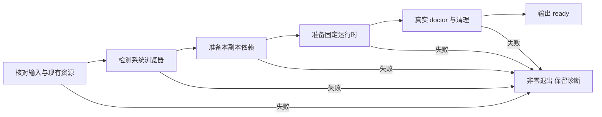

# Codex 本地打包、首次初始化与 onboarding

本文件是本地打包及 setup 的操作契约。实际版本、路径、摘要和验证状态统一见
[验收记录](acceptance.md)。本阶段只安装本机 Codex，不安装 DSH、不发布、不修改全局依赖。

## 身份与包

插件为 `ggb-plugin-demo`，构图 Skill 为 `ggb-demo-construction`，初始化 Skill 为
`setup`，本地来源为 `ggb-plugin-demo-local`。版本与根 package.json 一致。
[plugin.json](../plugin.json) 使用根 portable manifest，并声明：

```json
{"extensions":{"com.openai":{"onboardingSkill":"./skills/setup/SKILL.md"}}}
```

声明依据为 [OpenAI onboarding 契约](https://developers.openai.com/plugins/build/plugins#add-an-onboarding-skill)。
路径相对插件根，不在 .codex-plugin 目录。字段解析成功、原生 Skill 发现和 UI 按钮
可见是三个不同结果；脚本成功不能替代 UI 验证。

## 构建与打包

```sh
pnpm build
pnpm lint
pnpm check:skill
pnpm pack:codex
```

打包器返回 archive、sha256、marketplaceRoot、pluginRoot。每次创建新 output/packages
目录，不覆盖旧包。ZIP 是可注册的本地来源包，包含 .agents/plugins/marketplace.json、
plugins/ggb-plugin-demo 和文件摘要收据。插件内有预编译 dist/src、两个 Skill、viewer、
schema、示例、文档、安装脚本与锁文件。

包不带 node_modules、运行时、.setup、其他客户端缓存或用户产物。收据记录基线提交
和工作区是否有未提交变更，不把当前工作区冒称为纯提交快照。它不是来源签名。

## 注册与版本隔离

核对 ZIP 旁的 sha256 文件，再解压到新的持久来源根。使用当前本机 CLI 帮助确认接口：

```sh
codex plugin marketplace add <解压后的来源根绝对路径> --json
codex plugin add ggb-plugin-demo@ggb-plugin-demo-local --json
codex plugin list --marketplace ggb-plugin-demo-local --json
```

已有同名来源时先检查身份；不要覆盖其他来源。升级时使用新的来源目录和新版本，
由 Codex 原生命令更新本插件。保留旧版本安装、历史包与产物，不手写整个全局配置。
实际安装根从安装结果取得，不能猜测缓存路径。

## 首次初始化与可运行备用入口

从已加载 setup Skill 的目录计算安装根：`SKILL_DIR/../..`。依赖、运行时、诊断均在
该安装根准备；doctor 的用户证据写 workspace/output。workspace 必须已存在且在安装根之外。
完整资源布局见[安装资源契约](../skills/ggb-demo-construction/references/installation.md)。

不论 UI 是否显示 setup 按钮，均可从实际安装副本执行：

```sh
SKILL_DIR="<实际已安装 skills/setup 目录>"
PACKAGE_ROOT="$(cd "$SKILL_DIR/../.." && pwd)"
WORKSPACE="<现有用户 workspace 绝对路径>"
node "$PACKAGE_ROOT/scripts/setup-plugin.mjs" --workspace "$WORKSPACE"
```

也可在用户 workspace 中运行该脚本而不带参数，此时使用当前工作目录。未知参数、
不存在或位于安装根内的 workspace 均失败。脚本文件名保留用户指定的连字符接口；
内部 TypeScript 模块仍用 lower_snake_case。

安装包已带预编译 setup 模块，首次准备不需要 TypeScript 或 gts。脚本只接受 workspace，
不接受外部运行时 URL、任意浏览器路径或用户脚本。缺 Node.js 22+、pnpm 11.7.0、
curl、unzip 或系统 Chrome/Edge 时，报告缺项；不替用户改全局环境。

### 准备流程与现有状态

| 阶段 | 动作与门禁 |
| --- | --- |
| preflight | 核对安装身份、Node、固定 pnpm、预编译 CLI 和本地资源目录；拒绝资源根软链接 |
| existing-resources | 已有依赖版本和解析路径必须属于本安装；已有运行时摘要、receipt 与必需文件必须一致 |
| browser-detection | 探测真实系统浏览器及版本；优先 Chrome，缺少时尝试 Edge；不下载浏览器或扫描客户端缓存 |
| dependencies | 仅首次缺少 node_modules 时，在本副本执行 prod、frozen-lockfile、ignore-scripts 与独立 store 安装 |
| runtime | 固定官方包下载和 SHA-256 校验，保留许可；已有不匹配状态失败，不自动覆盖 |
| doctor | 调用本包 CLI 的真实 applet smoke；核对点类型、坐标、浏览器身份和资源清理 |
| ready | 上述全部通过后，才输出 installation-readiness 和本次 result.json |

已有依赖版本不符、缺失、解析到包外，或已有运行时损坏时，不用重装掩盖错误。
缺资源与不匹配要区分：全新副本可准备资源，已有残缺运行时需报告。相同资源再次
运行会复核并重新执行 doctor，不能仅凭前次 receipt 宣称就绪。

.setup/run-* 保留每次诊断，排他锁阻止并发修改。正常错误释放锁；进程被强制终止后
可能留下旧锁，应先确认进程和诊断，不自动删除。完整强制取消协议未在本段承诺。



### 输入、输出和失败语义

成功在 stdout 写一行 JSON，退出 0：ok=true，result.scope=installation-readiness，
status=ready，并返回安装根、workspace、版本、浏览器实际路径及版本、运行时身份、
依赖解析位置、真实 doctor 结果和诊断目录。

失败在 stderr 写 JSON，退出 1：ok=false、error.code=SETUP_FAILED，包含 stage、
message 及可取得的 diagnostics。参数或早期文件检查错误可没有诊断目录。
子进程错误日志可能先写入 stderr；调用方应按行读取，以最后一行 setup JSON 为最终结果，
不能把整个 stderr 当成单个 JSON 文档。
失败不得输出 ready；已下载文件和旧诊断保留，不自动删除或修改锁来规避失败。

doctor 的下载完成、setup Skill 可见或插件 enabled，都不能单独表示准备成功。
具体实现见 [setup_plugin.ts](../src/setup_plugin.ts)、
[setup-plugin.mjs](../scripts/setup-plugin.mjs) 和[共享浏览器检测](../src/browser_selection.ts)。

## setup Skill 与 UI 的验证边界

包内 [setup Skill](../skills/setup/SKILL.md)只指导初始化，不执行用户构图。
原生名称为 `ggb-plugin-demo:setup`；构图仍调用
`ggb-plugin-demo:ggb-demo-construction`。可在新聊天中显式选择 setup Skill。

安装后用新的原生 plugin/read 核对 onboardingSkill 指向包内 setup；skills/list
核对带命名空间的名称、路径、enabled 和解析错误。这些不等于 UI 按钮已显示。

若 UI 无法检查，记录“onboarding UI 未验证”，并执行上面的脚本备用入口。
不得把备用成功改写为用户已通过 setup UI 完成初始化。当前实际验证状态只在
[acceptance.md](acceptance.md)维护。

## 浏览器与其他未验项

安装器与 doctor、build、preview 共用浏览器检测。macOS、Windows、Linux 各有
候选路径；实际系统覆盖和 Edge 真实运行情况以验收记录为准，不能用版本输出夹具
冒充真实浏览器证据。全局 Node、pnpm 和浏览器只作为前置条件。

解压运行时逐文件审计、模型驱动的新会话与安装中会话 UI、完整双宿主首题和公开
发布仍需单独验收。Mermaid 保留图源，本文未做渲染验收。
