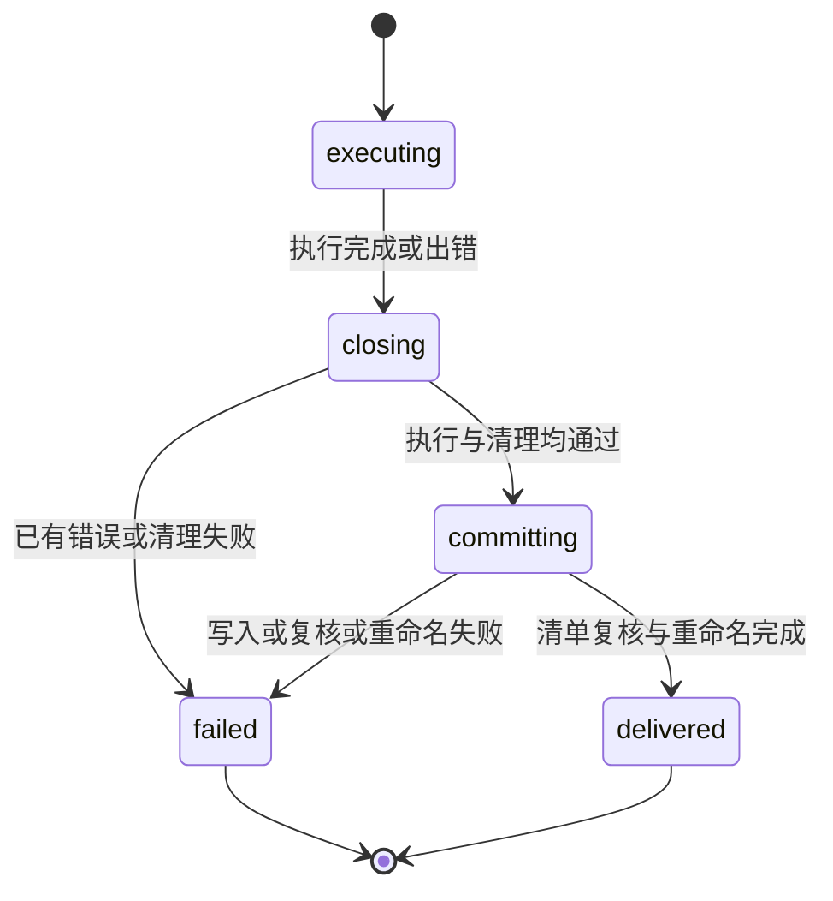
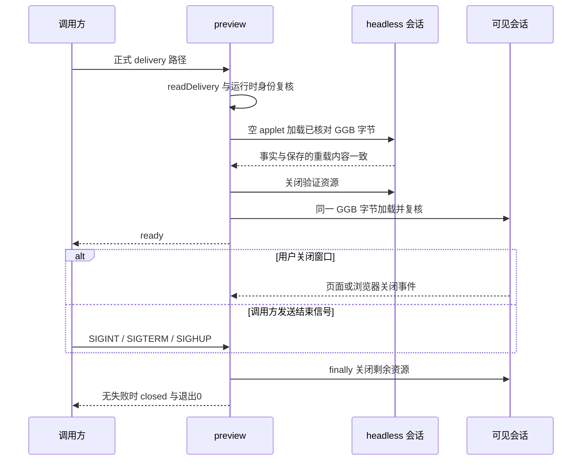

# 详细设计：模块职责、数据边界与执行门禁

本文基于当前代码工作树，解释各重点模块“如何实现、为什么这样分开、失败时如何处理”。
它补充[简要架构](arch.md)，不另定义一套请求、错误码或安装规范。
模型推理沿用宿主；GeoGebra 解释数学；本地代码控制执行、核验与交付。

## 1. 阅读范围与文档分工

| 内容 | 权威来源 | 本文补充什么 |
| --- | --- | --- |
| 功能范围与验收政策 | [requirements.md](requirements.md) | 哪些模块落实这些门禁 |
| 组件关系与主要数据 | [arch.md](arch.md) | 函数、调用方向、资源与失败边界 |
| Request、CLI 与交付格式 | [demo-contract.md](demo-contract.md) | 结构校验和事实判定各自发生在哪里 |
| Codex 打包、setup、安装 | [codex-installation.md](codex-installation.md) | 本副本资源检查与准备算法 |
| 已运行证据与未验项 | [acceptance.md](acceptance.md) | 测试应验证的设计性质，不重复历史结果 |
| 三角形逐阶段执行 | [triangle-execution-walkthrough.md](triangle-execution-walkthrough.md) | 跨案例复用的模块设计 |

文中的调用关系是实现说明，不表示每个宿主入口或平台都已验收。本文不运行新构图，
不安装或发布，也不改写已有验收证据。代码链接使用仓库相对路径；函数名用于快速定位。

## 2. 工程组织与执行边界

工程是单包 TypeScript ESM CLI。NodeNext 编译 src 和 tests 到 dist，代码使用 .js
导入路径，运行入口为 dist/src/cli.js。viewer 和 schema 仍从安装根读取，tsc 不复制
这些资源。因此只带 cli.js 不足以组成可运行包。

主要运行依赖只有 Ajv 和 Playwright：前者检查 JSON 结构，后者控制系统浏览器。
Google gts、TypeScript 和 Node 类型用于开发构建，不是首次用户构图的模型服务。
实现配置见 [package.json](../package.json)、[tsconfig.json](../tsconfig.json)。

| 层 | 主要对象与模块 | 数据或控制方向 |
| --- | --- | --- |
| 宿主使用层 | Agent、构图 Skill、setup Skill | 写请求、调用本地入口、读结果 |
| 输入层 | cli、request、schema | 不可信 JSON → 已预检 Request |
| 执行层 | pipeline、browser、server、viewer、GeoGebra | Request → 原生对象、XML、事实与 GGB 字节 |
| 判定层 | verify、interaction | Request + Facts + 交互证据 → 检查结果 |
| 文件层 | delivery、preview | 保存记录复核、同一 GGB 字节加载 |
| 准备层 | package_plugin、setup_plugin、runtime、browser_selection | 安装副本 → 可运行资源与就绪证据 |

纯判定模块不拥有浏览器或正式目录；pipeline 才拥有构图提交动作。这样可以用纯函数
测试复杂失败条件，再用真实引擎集成验证事实来源与实际执行。

## 3. 核心数据模型：声明、事实和产物必须分开

类型定义位于 [request.ts](../src/request.ts) 与 [verify.ts](../src/verify.ts)。

| 数据 | 生产者 | 消费者 | 关键性质 |
| --- | --- | --- | --- |
| Request | Agent 或人工调用方 | request、viewer、verify、pipeline | 保存原文、选择、原生程序和验收声明；不是通过证据 |
| Fact / Facts | 可信 viewer 读取 Engine | verify、interaction、delivery、preview | 包含实际类型、定义状态、依赖、坐标和样式；没有由模型指定的 passed |
| 阶段报告 | verifyRequest 与管线 | 要求汇总、delivery、Agent | expected 与 actual 同时保存，结果可以重算 |
| DragEvidence / DragReport | browser / pipeline 收集，interaction 判定 | delivery、Agent | 同时记录独立加载身份、指针动作、视口、前后事实与截图路径 |
| GGB | Engine 原生导出，pipeline 写盘 | 独立重载与 preview | 是可重载的 ZIP 构造包，不是截图或改扩展名的 XML |
| manifest | pipeline 在关闭资源后生成 | readDelivery | 关联请求、输出和各文件摘要；不包含自身摘要，也不是来源签名 |

XML 有两种用途：getXML 保存构造序列化，getAlgorithmXML 提供对象算法输入。
桥接把后者解析为 parents，原始 XML 也写盘保留。verifyChecks 比较的是整理后的
Fact，不是验证整个 XML 文档。GGB 中的 geogebra.xml 则由文件审计模块另外检查。

## 4. Skill 与 Agent：使用协议，不是执行器

入口见[构图 Skill](../skills/ggb-demo-construction/SKILL.md)与
[setup Skill](../skills/setup/SKILL.md)。两者随插件包分发，职责不同：

- 构图 Skill 指导提取原文条件、单列演示选择、写请求、check、build、读报告和 preview。
- setup Skill 指导首次资源准备或安装故障诊断，不负责用户图形构造。
- references 保存安装定位、请求使用和报告阅读规则，examples 保存具体案例。
  通用正文不内嵌单题构图路由。

Agent 使用宿主 LLM 生成请求和分析诊断；本工程没有内部模型推理 API。
调用方不能把自己生成的检查清单视为原题完整性的证明，仍需对照原文复核。

失败时，CLI 返回诊断而不是自行再次调用模型。Agent 按 Skill 决定是否修复，最多
两次自动修复；每次另存请求、开启新运行，不能删条件、删检查或放宽容差。
该次数是宿主工作流规则，不是 CLI 持久化计数器。流程见
[架构中的失败修复](arch.md#agent-接收失败后的修复流程)。

## 5. cli.ts：严格分派与结果封装

源码：[cli.ts](../src/cli.ts)。它负责进程级接口，不负责数学判定。

### 5.1 定位规则

安装根由模块自身路径定位，用于找 package、schema、viewer 和 runtime。
outputRoot 则是调用方 cwd/output；请求和 delivery 参数按调用工作目录解释。
这使安装副本可以服务不同 workspace，而不把用户产物写入安装包。

### 5.2 分派设计

| 命令 | CLI 调用 | 关键区别 |
| --- | --- | --- |
| check | readRequest 后直接返回预检结果 | 不启动引擎，mathematicalValidity 为 not-evaluated |
| doctor | runTool 的 doctor 分支 | 构造固定原生点做就绪检查，不构造用户题目 |
| build | readRequest 后调用 runTool | 不依赖之前 check 的缓存结果 |
| preview | 调用 preview，并提供 ready 输出回调 | 长生命周期，ready 后还要等待最终结果 |

参数形状固定，拒绝缺失、重复、多余选项和不合规路径值。这样调用方不会误以为
未支持参数已经生效。响应 schemaVersion 由 CLI 包装，不让下游模块随意输出成功文本。

成功业务 JSON 写 stdout；失败包装 ToolError 写 stderr，设置非零退出码。
帮助和版本是文本入口，不能用“任意 stdout”判断构图成功。
退出码全集见[错误契约](demo-contract.md#超时错误与限制)。

## 6. request.ts 与 schema：预检不解释数学

源码：[request.ts](../src/request.ts)、[request.schema.json](../schemas/request.schema.json)。

readRequest 先 stat 检查文件容量，再读取、解析 JSON。Ajv 在模块加载时编译一次
schema，每个新请求仍重新验证；不做类型强转、默认值填充或未知字段删除。

parseRequest 在结构通过后执行引用与覆盖检查：

1. 建立 requirement 集合，拒绝重复 id。
2. 按 program 顺序维护 known 标签，拒绝重名、保留前缀、未知裸引用与前向引用。
3. 建立 check id 与对象检查集合，核对 requirement、label 和 parents 引用。
4. 要求每个主程序标签有对象检查，每个声明输出有程序对象及检查。
5. 检查样式目标、重复样式、交互 id、样本引用、不同端点和 view 上下界。
6. 要求每条声明 requirement 至少关联检查、样式或交互。

覆盖只针对已声明清单。工具不通过题目关键词推断漏了哪条数学要求。

expression 扫描原生表达式的词法边界，拒绝脚本分隔、字符串、额外赋值、保留标识
和受限副作用命令。数值字面量先移除，避免把科学计数中的 e 当引用。
命令或函数调用名仍交给 GeoGebra 解析，不维护数学命令白名单。因此未知原生命令
可以预检通过，之后在 Engine 执行阶段失败。这是有意保留的责任边界。

## 7. runtime 与准备脚本：固定身份和首次准备分离

源码：[runtime.ts](../src/runtime.ts)、[setup_runtime.mjs](../scripts/setup_runtime.mjs)、
[runtime.lock.json](../runtime.lock.json)。

runtimeIdentity 是只读身份检查：读取锁和 receipt，重算本安装压缩包 SHA-256，
比较版本、来源与摘要，确认加载器可读取，记录许可快照摘要。
actual applet 版本由后续事实采集核对；它不能由“文件存在”推导。

setup_runtime.mjs 才承担准备动作：只接受锁定官方地址，下载到本副本，先验摘要，
保留官方许可，在独立目录解压并写 receipt，最后重命名提交 runtime。
已有 receipt 不匹配、损坏，或 runtime 目录存在却无有效 receipt，都失败并保留原状。

设计上，运行时准备和运行时使用不混在一起：build 不会在缺环境时自动联网安装。
当前只核对压缩包与来源记录，没有逐文件重算解压树；身份结果明确标记这一限制。
许可摘要也是观测记录，不是发布签名。

## 8. browser_selection 与 server：只选本机浏览器，只服务本地资源

源码：[browser_selection.ts](../src/browser_selection.ts)、[server.ts](../src/server.ts)。

### 8.1 浏览器选择

systemBrowserCandidates 枚举受支持系统位置及 PATH。detectBrowser 按品牌优先级
尝试候选：确认可执行，探测版本和品牌，再返回 realpath 与版本记录。
优先可用 Chrome，之后尝试 Edge；不提供任意环境变量执行路径入口，不扫描其他
插件或 Playwright 浏览器缓存，也不下载浏览器。

setup 与 EngineSession 复用同一检测函数。setup 还核对 doctor 的实际 executablePath
与本次检测一致，避免“准备时发现一个浏览器，执行时用了另一个”。
平台与真实 Edge 覆盖情况以验收记录为准，候选代码和版本夹具不等于实机验收。

### 8.2 回环资源服务

startServer 在随机 127.0.0.1 端口监听。只允许 GET 和预期 Host 形状，提供固定
viewer / bridge 路由，以及 realpath 限定的 GeoGebra 运行时子树。
目录前缀附分隔符，避免把相邻同名前缀目录误判为子目录；realpath 防止软链接逃逸。

拒绝统一返回 403，响应不暴露底层磁盘路径。每次请求的路径与状态记录到会话，
供后续诊断。浏览器路由限制与服务文件边界各自负责一层约束，不相互替代。

## 9. EngineSession：资源生命周期的唯一会话所有者

源码：[browser.ts](../src/browser.ts)。一次 session 拥有 server、browser、context、
page、browserSelection、log 和 blocked。构造函数本身不启动资源。

| 方法 | 前置条件与动作 | 设计原因 |
| --- | --- | --- |
| launch | 检测系统浏览器，启动本次回环服务与专用浏览器 | 不附着用户浏览器，也不复用其他进程状态 |
| freshApplet | 关闭旧 page / context，新建上下文，安装请求限制，加载固定页面并等待 ready，核对对象数为 0 | 文件重载必须从空构造开始 |
| run | 在已就绪页面中传递 Request 数据给 window.runRequest | 不把模型文本拼接成 JavaScript |
| snapshot / xml | 调用可信桥接或原生 API | 采集与判定分开 |
| exportGgb / loadGgb | 等待原生回调，传递 base64 字节 | 不手工生成 GGB，不用请求重画替代加载 |
| viewProperties / visible / drag | 读取原生视口和可见性，真实鼠标按下、移动、松开 | 交互证据对应实际画布 |
| close | 独立尝试关闭每个资源，汇总状态 | 一个关闭失败不能跳过其余资源 |

上下文在导航前安装同源 GET 限制，阻止外部请求和 WebSocket，并禁用 service worker
与下载。console 和 pageerror 进入日志；出现 blocked 请求会阻止 build 正式交付。

bounded 用 Promise.race 为桥接调用加 Node 侧上限，成功或失败后清理定时器。
它只结束等待，不取消底层引擎操作；调用方仍须 finally 关闭 session。
页面关闭、浏览器关闭等动作没有因此自动获得同一桥接超时机制。

close 逐项记录 page、context、browser、server，再检查 browserDisconnected 与
serverStopped。全部满足才得到 cleanup.ok=true。调用者必须处理关闭失败；会话不会
在自己的 close 里宣布整个请求已经成功。完整取消协议尚未覆盖所有构图与 setup 路径。

## 10. viewer / Engine 桥接：受控 API 与原生数学

源码：[engine.html](../viewer/engine.html)、[engine.js](../viewer/engine.js)。

页面加载本地 deployggb.js 与固定 bridge。GGBApplet 的 appletOnLoad 回调取得 API
后才设置 ready。官方资源目录中的 5.0 是包布局，实际版本另从 API 核对。
关闭工具栏、输入区和文件相关入口，是固定执行页面的一部分，不表示数学结果通过。

### 10.1 原生命令与探针

runRequest 按 program 顺序检查标签未存在，再执行 label=expression，要求命令
成功且主标签确实产生。数学重载、对象类型和依赖由 Engine 决定。
自动生成对象也可能占用标签，不能依赖 schema 的主标签唯一性跳过运行时覆盖检查。

boolean 检查按完整 checks 索引建立 ggbCheck 探针。verifyChecks 也用同一索引读取，
不能把 boolean 项过滤重排后重新编号。探针作为原生对象参与导出和动态重算，
显示被隐藏，构图截图只呈现绘图区。

样式只通过固定 setColor、setLabelVisible、setLabelStyle 应用，颜色转成 RGB 数值。
调用方不能因工具自己使用这些 API，就在模型 program 中执行任意 Set* 命令。

### 10.2 API、XML 与 Facts 的来源

snapshot 枚举全部对象，读取 exists、isDefined、getObjectType、isIndependent、坐标、
颜色、标签和显示值。boolean 才读取 numericValue，numeric 的值 1 不被当作真值探针。
parents 从 getAlgorithmXML 的 command/input 读取，不从坐标或模型声明反推。

getXML 另用于解析 slider 设置与脚本元素，并保留完整构造序列化。
slider fact 记录 min、max、width、horizontal、showAlgebra；它不是“所有滑块位置
都执行过”的证据，也没有自动变成请求中的范围期望比较。

### 10.3 XML、GGB 与 script 的区别

getBase64 导出原生 GGB；setBase64 加载同一构造包。GGB 内包含 geogebra.xml 等条目，
不是 XML 文本换一个后缀。加载完成后桥接切换显示视图，不执行 program 重建对象。

program 是 GeoGebra 命令序列；engine.js 是项目自有可信 JavaScript；GGB 还可能含
嵌入 JavaScript / GGBScript。三者不同。只有前两种以当前受控形式使用，第三种受
导出包审计约束，不能作为模型绕过命令限制的执行入口。

## 11. verify.ts：纯函数判定，不拥有执行或提交权限

源码：[verify.ts](../src/verify.ts)。输入为 Request 与 Facts，输出为检查与阶段报告。

### 11.1 verifyChecks

object 检查始终要求对象存在且已定义。type、parents、coordinates 都是可选期望，
只有请求实际声明时才比较；parents 按原生输入顺序比较，并要求独立性与空父列表一致。
坐标期望只接受二维点，并使用工具固定的绝对容差。

boolean 检查通过完整索引找到 ggbCheck 对象，要求存在、已定义、类型 boolean、
numericValue=1。这避免“文本显示 true”或普通 numeric 的 1 冒充关系通过。

verifyChecks 返回结果数组，不返回总布尔值。ids 可选择子集；stripCoordinates 会
移除对象的初态坐标期望，保留类型和父对象约束。调用方必须明确当前检查范围，
不能把子集或去坐标后的通过扩大成完整请求通过。

### 11.2 verifyStyles 与 verifyRequest

verifyStyles 单独比较颜色、labelVisible 和名称模式。没有样式期望并不自动证明外观
符合原题，仍依赖 Agent 完整声明。标签显示为 false 时，当前代码仍会核对名称模式。

verifyRequest 汇总对象 / boolean、样式，并要求实际对象集合非空、全部存在且已定义，
所有类型受支持。自动生成的边和探针也在范围内。这只是当前阶段通过，不含文件
导出、独立重载、交互位移或资源退出。

### 11.3 compareReload 与 summarizeRequirements

compareReload 按标签排序，比较稳定内容：类型、独立性、父对象、坐标、样式、
slider 设置、原生命令、显示值及脚本。它不按枚举顺序或 XML 字符串相同来判定，
也不比较截图像素。两个阶段各自的存在和定义状态由 verifyRequest 检查。

summarizeRequirements 关联 initial、reloaded、样式和适用交互。没有任何关联证据则
为 unverified，有失败证据则 failed。它不重新解释原题，也不补造新的数学条件。

## 12. interaction.ts：从真实动作到可重算的交互报告

源码：[interaction.ts](../src/interaction.ts)；执行者在 browser 与 pipeline，判定函数
本身不发送鼠标事件。DragEvidence 连接两侧：加载身份、指针、视口、可见性和截图。

### 12.1 坐标与命中

GeoGebra 世界坐标经实际 viewProperties 换算成浏览器像素，y 轴方向在换算中反转。
视口必须数值有限、宽高和比例有效，拖动期间不能平移或缩放。
声明目标必须是可见、已定义的独立 point，from 要与拖动前原生坐标匹配。

nearbyPoints 根据实际点坐标和视口列出附近候选。evaluateDrag 会重新计算候选，
不能只相信保存数组；鼠标起点有歧义则失败。附近候选还保留到报告供诊断。
起点与目标必须在画布内，指针记录应对应计算出的像素。

### 12.2 动作后需要保持什么

管线使用真实 mouse.down、连续 move 和 mouse.up，再读取原生事实。
判定同时要求实际位移和目标误差达标，按下、松开与移动步数证据完整；不能用
SetCoords 或一次数值赋值制造同样的坐标结果。

核验分成两组：sample.checks 指定的检查按原期望执行；invariants 则对全量 checks
去除初态坐标后执行。若显式选中的检查仍要求移动点保持旧坐标，它仍会失败。
因此关系样本应声明真正需要保持的关系，不能认为交互阶段无条件忽略所有坐标。

还要求样式通过、所有对象已定义且类型受支持、对象标签集合不变、其他独立点未移。
每个样本记录世界位移、像素位移、目标误差和失败 reasons。阈值是工具常量，
不允许模型通过请求调整；其具体值见[交互契约](demo-contract.md#请求-schema-与引用)。

独立空 applet 与加载一致性由 pipeline 提供，delivery 再核对文件和重算报告。
PNG 签名与文件摘要只检查记录的格式和身份，不构成第三方签名或一般数学证明。

## 13. pipeline.ts：阶段执行与证据先行

源码：[pipeline.ts](../src/pipeline.ts)，公共入口 runTool(command, root, request, outputRoot)。
它拥有一次 doctor / build 的 session、暂存目录、stage、reports、error 与 cleanup。

### 13.1 阶段数据与 doctor 分支

先创建唯一暂存区，保存请求、检查能力、核对运行时并复制许可，再启动浏览器。
capture 先写 facts JSON、XML 和真实截图，再核对实际引擎版本，失败时仍能追溯观测。

选择 doctor 时只执行固定 DoctorPoint=(1,2)，核对 point 与坐标后进入清理和证据保存。
返回 runtime-readiness；manifest.kind 是 doctor-evidence。它不走用户构图和正式
readDelivery 门禁，也不证明用户题目成立。

### 13.2 build 的执行阶段

| 阶段 | 输入 → 输出 | 必须保持的设计性质 |
| --- | --- | --- |
| construction / initial-verification | Request → constructed 事实与 initial 报告 | 原生定义与声明、样式匹配；脚本与空态审计一致 |
| export | Engine → 磁盘 construction.ggb | 字节来自原生导出，ZIP 与内容审计通过 |
| reload | 磁盘文件 → 新空 applet → reloaded 事实 | 关闭旧上下文，重新 readFile，不重画或复用内存 |
| reload-verification | 两阶段事实 → 报告与 contentEqual | 再执行阶段检查并比较稳定内容 |
| interaction | 同一磁盘 GGB → 每个新空 applet → 前后证据 | 每个样本独立加载，来源摘要不变，真实鼠标门禁通过 |
| summary | 阶段与样本报告 → requirements | 请求适用的样本数、每样本状态和逐要求结果全部满足 |

管线可能写入暂时 passed 的 verification.json，然后继续重载、交互或清理。
这个文件的中间状态不是正式交付承诺。交互判定 failed 可以先记录并继续收集后续
样本，最后汇总失败；执行异常则转入 catch / finally。

### 13.3 清理与正式提交

此图是 build 的概念状态，不是代码另建的持久化状态机。输入预检失败发生在该图之外。

finally 无论执行是否失败都调用 session.close，并保存 cleanup、浏览器日志与资源请求。
若清理失败，最终错误为 CLEANUP_FAILED；原执行错误在已保存的 failure 记录中仍可查。

只有清理成功且没有错误，才生成 manifest，调用 readDelivery 复核，再分配独占
父目录并将暂存区重命名为新的 delivery 子目录。重命名失败不得返回成功路径。
已提交目录不按 title 命名，重复构建不会覆盖旧结果。

## 14. delivery.ts：消费端标准也用于提交前自检

源码：[delivery.ts](../src/delivery.ts)。核心是 auditGgb、assertCapabilities、readDelivery。

### 14.1 GGB 不是任意导入入口

auditGgb 使用 execFileSync 调用 unzip，不拼 shell；限制子进程耗时与输出容量。
检查 ZIP 完整性、必须存在的构图 XML、重复和不允许的条目。只接受当前工具导出的
基础子集，拒绝宏、图片资源、自定义 JavaScript 和 GGBScript 等内容。
默认空 ggbOnInit 函数可保留；XML 按当前规则拒绝脚本、外部内容和特定声明形式。
这不是通用外部 GGB 清洗器，不能推导能安全导入任意附件。

assertCapabilities 当前只接受已声明的 drag 交互形状；结构 schema 也拒绝其他形状。
未来增加能力必须同时补执行和核验，不可仅让 schema 接受后静默跳过。

### 14.2 完整目录读取顺序

1. 解析 delivery 的真实目录，读取有界普通 manifest 文件。
2. 检查版本、kind、GGB 文件名、清单数量与安全文件名。
3. 要求目录条目与清单精确对应；叶文件不能是软链接、目录或超限文件。
4. 读取字节并核对每项摘要，检查基础与按交互动态展开的必需证据。
5. 重新 parseRequest，核对请求摘要、输出身份、cleanup 和报告门禁。
6. 从 constructed / reloaded Facts 重算 verifyRequest 与 compareReload，并比较已保存报告。
7. 核对运行时身份、所有必需 PNG 签名、每个样本的来源与前后事实，再重算交互和要求汇总。
8. 审计 GGB 内容，返回已核对的 GGB Buffer、摘要、请求与重载事实。

阶段 JSON / XML / PNG、日志和许可均在必需清单内。目录与 manifest 同时删掉一个
必需文件仍失败；不是“只要剩下的 hash 一致就算完整”。必需文件全集与容量见
[交付契约](demo-contract.md#构图与交付文件)，不在本文重复维护。

readDelivery 从保存的事实重算判定，但这些记录不是可信来源签名。preview 还会用
真实引擎重新加载 GGB。文件摘要证明内容对应，不证明任意人重写的整个目录属于某次
可信运行，也不能替代对原题完整性的审核。

## 15. preview.ts：同字节复核与长生命周期展示

源码：[preview.ts](../src/preview.ts)。它不调用 runRequest，不修改正式交付。

先做文件复核，成功后才创建独立预览诊断目录；无效交付路径不应触发浏览器。
身份复核比较本地与交付 runtime 版本和压缩包摘要。两个加载阶段都比较实际引擎
版本、请求检查、重载内容及 blocked 状态，不只是能在窗口显示图形。

closeCurrent 将每个会话的清理、实际浏览器选择、请求和日志分别存入 exits。
headless 关闭通过后才开可见窗口，不能让后一个会话成功掩盖前一个关闭失败。
readDelivery 重算保存的鼠标证据；preview 本身不重新执行全部自动鼠标样本。

preview 注册自己的 SIGINT、SIGTERM、SIGHUP 处理，禁用 Playwright 默认信号退出。
就绪前收到信号会在阶段边界变成 CANCELLED；就绪后信号唤醒等待，进入 finally。
监听器退出时移除，避免污染后续调用。不是所有进行中的操作都会在信号瞬间终止。

ready 是窗口可交互，不是资源已退出。仅在清理完成且无失败后返回 closed；调用方
还应检查最终退出码。用户拖动只改变内存，原交付保持不变。详细事件见
[preview 契约](demo-contract.md#preview-的完整性与生命周期)。

## 16. setup_plugin：安装副本的准备事务边界

源码：[setup_plugin.ts](../src/setup_plugin.ts)、[setup-plugin.mjs](../scripts/setup-plugin.mjs)。
稳定脚本入口保留连字符，内部模块使用 lower_snake_case；它直接使用包内预编译模块，
首次准备不需要 TypeScript 编译器。

setupPlugin 的 installationRoot 来自脚本自身位置，workspace 必须是已存在、位于
安装根外的目录。前者接收依赖、runtime 与准备诊断，后者只接收 doctor 用户证据。
两种位置不能混为一个输出根。

| 检查或动作 | 实现要点 | 为什么这样设计 |
| --- | --- | --- |
| assertLocalResources | 资源根必须是本地目录，不接受根软链接 | 避免直接借用其他安装或缓存 |
| 排他锁 | .setup/lock 用独占创建，正常退出 finally 释放 | 避免并发安装互相覆盖；旧锁不自动删除 |
| 身份与工具链 | 核对 plugin/package 名称和版本、预编译 CLI、Node 与固定 pnpm | 不把另一个包或未准备构建当成当前安装 |
| inspectDependencies | 顶层 node_modules 不存在才是首次安装；已有依赖必须版本正确且 realpath 在本副本 | 残缺或不匹配不能用重装掩盖 |
| inspectRuntime | 先校验已有 archive 与 receipt；已有 runtime 须满足身份与说明文件检查 | 损坏状态不当成全新缺资源 |
| 依赖准备 | 本副本 prod、frozen-lockfile、ignore-scripts、独立 store；子进程清空 NODE_PATH | 不修改全局依赖，不借包外解析位置 |
| 冻结输入 | 安装前后核对 package 与 lock 摘要 | 防止准备过程中锁输入发生变化 |
| doctor | 从外部 workspace 调用本包 CLI，检查 scope、cleanup 和实际浏览器 | 下载完成不等于 applet 可执行 |

setup 在 .setup/run-* 保存分阶段日志；全部门禁完成后写安装就绪结果并返回。
异常转 SetupError，外层脚本输出最终 SETUP_FAILED JSON 和非零退出码。
子进程 stderr 可能先出现日志，调用方应按[setup 输出协议](codex-installation.md#输入输出和失败语义)
解析最终结果，不把整个 stderr 当一个 JSON 文档。

这不是自动回滚事务：失败保留已下载资源和诊断，不清空旧目录。锁释放失败仍能使
入口失败；强制终止可能遗留锁，须先诊断，不自动删除绕过。setup 也不注册插件。

## 17. package_plugin：白名单快照，不借构建缓存

源码：[package_plugin.ts](../src/package_plugin.ts)、[pack_codex.mjs](../scripts/pack_codex.mjs)、
[plugin.json](../plugin.json)。

packagePlugin 输入源码根和输出父目录，先核对插件与 private package 身份、版本。
每次分配新 codex-package 目录，按根白名单递归复制本工程文件。拒绝软链接和特殊
文件，跳过构建缓存信息与系统杂项，再核对必须存在的编译入口、viewer、schema、
构图与 setup Skill 以及准备脚本。

随后生成本地 marketplace 描述与 package-receipt，记录各插件文件摘要、Git HEAD
和工作区 dirty 状态。最后生成 ZIP，检查归档可读，再输出归档 SHA-256。
归档不含 node_modules、runtime、.setup、用户 output 或其他客户端缓存。
它携带的是在安装副本独立准备这些资源的能力，不是复制开发环境。

打包入口的输出位于工程 output/packages，与业务 cwd/output 的规则不同。
打包器不执行 Codex 注册和安装；这些动作交给经授权的原生命令，操作规范见
[本地安装契约](codex-installation.md)。onboardingSkill 是 manifest 声明，解析成功
不等于 UI 按钮已显示，更不等于用户已经通过该 UI 完成初始化。

## 18. 固定实验、反例演示与录像诊断

| 入口 | 复用内容与独立目的 | 不允许的解释 |
| --- | --- | --- |
| [experiment.ts](../src/experiment.ts) 与 [experiment_support.ts](../src/experiment_support.ts) | 共享 runtime / browser / server，固定页面程序与独立断言验证三角形机制 | 不能把固定配方放入生产请求路由，不能称为正式交付接口 |
| [demo_counterexample.ts](../src/demo_counterexample.ts) | 调用 CLI，演示正例、静态中点预期拒绝与修复复验 | 退出 0 表示观察到预期结果，不表示错误构图成功 |
| [drag_diagnostic.ts](../src/drag_diagnostic.ts) | 使用专用录制资源，保存连续真实鼠标操作与 NOT_A_DELIVERY 标记 | 录像不能替代 build 的独立重载和正式核验 |
| [browser_smoke.mjs](../scripts/browser_smoke.mjs) | 独立浏览器启动诊断 | 不等于真实 GeoGebra doctor smoke |

固定实验及演示入口使用工程自己的技术输出目录。它们不是用户运行时默认路径，
不应从“复用了底层模块”推导它们拥有同样的交付语义。
具体实验历史与命令见[技术实验记录](technical-experiment.md)。

## 19. 错误、阶段记录与资源归属

[ToolError](../src/errors.ts)只保留稳定 code、解释 message 和可选 diagnostics。
模块不直接猜测最终对外成功响应，由 CLI 封装退出结果。

| 情况 | 当前处理位置 | 对调用方的意义 |
| --- | --- | --- |
| 参数 / 输入不合法 | cli / request | 可能尚无诊断目录，不启动引擎 |
| 执行失败 | pipeline catch | 保存可取得的 failure、事实和截图，finally 清理 |
| 清理失败 | pipeline / preview | 阻止对应成功结果；检查 cleanup 中具体资源 |
| 提交阶段失败 | pipeline 最后的 catch | 返回 DELIVERY_ERROR 与暂存位置，不保证另写执行阶段 failure.json |
| readDelivery 失败 | delivery | 通常包装为 PREVIEW_ERROR；build 提交前调用它时，外层再包装为 DELIVERY_ERROR |
| 安装准备失败 | SetupError / setup 入口 | 独立阶段与日志协议，不复用构图业务 JSON 全部字段 |

诊断保存本身也可能因磁盘权限或容量失败，不能承诺所有异常都有完整截图或报告。
失败返回非零、不给正式成功路径，比假造一个完整诊断更重要。

| 资源 | 所有者 | 结束条件 |
| --- | --- | --- |
| browser / context / page / loopback server | EngineSession，由 pipeline / preview / experiment 调用关闭 | 逐项关闭结果通过，浏览器断开且服务停止 |
| 初态、重载、交互证据与正式目标 | pipeline | 失败留暂存，成功复核后重命名提交 |
| preview 会话与信号监听器 | preview | 当前会话清理，移除自身监听器，保存每会话结果 |
| 安装依赖、runtime 与 .setup/lock | setupPlugin / 准备脚本 | 成功或正常错误释放锁；不自动清空资源 |
| ZIP、本地来源与旧安装版本 | 打包器及经授权的宿主安装流程 | 新目录产物不覆盖旧版本；不能用一次 setup 清理其他插件 |

## 20. 测试定位与设计变化时的检查顺序

| 设计性质 | 对应测试或证据入口 |
| --- | --- |
| 严格参数、结构化错误、check 不启动引擎 | [cli.test.ts](../tests/cli.test.ts) |
| 引用、容量、脚本边界、静态中点与原生 boolean 判定 | [request.test.ts](../tests/request.test.ts) |
| 桥接等待超时后返回 TIMEOUT | [browser_timeout.test.ts](../tests/browser_timeout.test.ts) |
| 固定路由与 runtime 文件边界 | [experiment_server.test.ts](../tests/experiment_server.test.ts) |
| 命中、位移、视口、依赖与独立点约束 | [interaction.test.ts](../tests/interaction.test.ts) |
| 不完整与不安全目录预拒绝 | [delivery.test.ts](../tests/delivery.test.ts) |
| 真实构造、重载、拖动、错误变体、证据篡改、preview 退出与 workspace 输出 | [integration.test.ts](../tests/integration.test.ts) |
| Skill 元数据、链接和 CLI 定位规则 | [skill.test.ts](../tests/skill.test.ts)、[check_skill.mjs](../scripts/check_skill.mjs) |
| 包清单、资源齐备和身份不匹配拒绝 | [package_plugin.test.ts](../tests/package_plugin.test.ts) |
| 已有依赖冲突、资源软链接、损坏运行时、参数拒绝与浏览器选择夹具 | [setup_plugin.test.ts](../tests/setup_plugin.test.ts) |

纯函数测试的合成 facts 只验证判定逻辑，不构成真实引擎证据。版本输出夹具只验证
选择逻辑，不证明真实 Edge applet 可用。真实测试的执行日期和结果只记录在
[acceptance.md](acceptance.md)，本文不把测试存在写成已经执行通过。

修改 schema 或 Fact 字段时，要追踪 request → viewer → verify / interaction →
pipeline 记录 → delivery 重算 → preview 实时复核，避免只改写入方而漏掉消费方。
新增数学案例优先改变请求；新增能力必须同时补支持范围、执行、核验、拒绝路径和
真实引擎证据，不能只在 schema 放行。机械风格与命令入口见[仓库约定](../AGENTS.md)。

## 21. 当前限制与本次文档验证

当前没有一般数学证明器、原文完整性自动审核器、CLI 模型修复器或持久化调度器。
本地 Codex 安装、宿主发现、UI、新会话模型驱动首题、双宿主、独立安装、取消协议、
运行时逐文件审计和更多数学范围，应分别按[验收记录](acceptance.md)读取真实状态。

本文只补充模块详细设计，没有改应用代码、依赖、安装或产物。
本次检查文档链接、锚点、代码符号与 Markdown 格式；没有重跑构图和安装验收。
Mermaid 保留可编辑图源，仅做静态核对，未做渲染验收。
