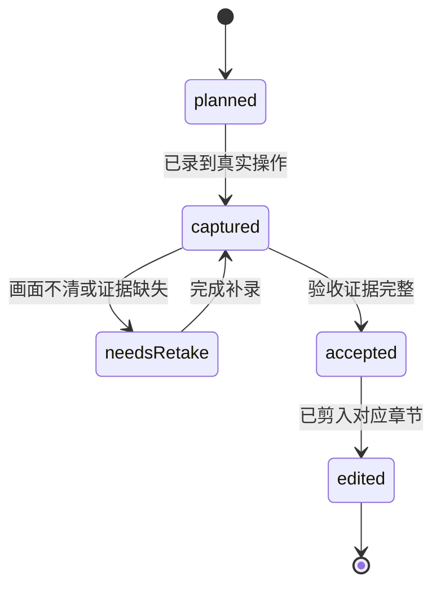

# Codex 与 DSH 插件从零开发录屏脚本

本脚本用于分段录制教学版 ggb-plugin-demo，再剪成约 28 分钟的视频。开发以 ggb-plugins 的方法和责任边界为参考，从教学仓库的空工程开始，完成构图、核验、Skill、双宿主接入、安装和发布后验收。

本篇是第一轮，只验收三角形案例的端到端路径，不据此宣称二维数学能力已经通用或稳定。首轮发布后继续录制 [能力矩阵与持续迭代脚本](capability-iteration-script.md)：设计跨域正反例、建立基线、修复共享机制、评估未见题，再发布下一版本。第二篇约 20 分钟，两篇合计约 48 分钟。

本文是录制方案。文中提示词、接口和命令是待实现的教学目标，不表示教学仓库已经具备这些能力。编写本脚本时，教学仓库只有 AGENTS.md 和空 docs 目录。本文不执行开发、安装、提交或公开发布。

## 1 录制前统一约定

### 1.1 教学范围与贯穿案例

统一题目：

> 作三角形 ABC，取 AB 的中点 M，连接 CM。将 M 和 CM 标红，显示点名。拖动 A 后检查中点关系和中线联动，保存可重载的 GGB、核验报告和截图。

首次示例采用 A=(0,0)、B=(6,0)、C=(2,4)。这些坐标是演示初始构型，不是用户额外给定的数学条件。录制时须说明选择。

第一轮只实现这条完整教学路径；第二轮按独立脚本扩展数学域并补齐证据。新增能力须先修订需求与支持范围。数学输入使用 GeoGebra 原生命令，具体命令和引用限制由教学版输入契约规定；不建立题型关键词路由，不包装第二套数学命令语言。已有 GGB 编辑、复杂 CAS、Worker、MCP、WorkBuddy 和公共插件目录收录不属于本片验收范围。

录制遵守 [requirements](requirements.md) 的验收门禁和 [demo-contract](demo-contract.md) 的接口；本脚本只记录拍摄与素材，不重复定义门禁。有限交互样本不代表一般数学证明。

### 1.2 工作目录与命名

| 对象 | 固定约定 | 注意事项 |
| --- | --- | --- |
| 教学仓库 | `/Users/lijunqiang1/workspace/ggb-plugin-demo` | 所有开发聊天在此项目内进行；先核对实际路径 |
| 样板仓库 | `/Users/lijunqiang1/workspace/ggb-plugins` | 只读参考；不能借它的 dist、runtime 或 node_modules 验收 |
| 教学 CLI | `node dist/src/cli.js` | 第 04 段实现后才能运行 |
| Codex 插件名 | `ggb-plugin-demo` | 与现有 `ggb-plugins` 分开 |
| Codex 本地来源 | `ggb-plugin-demo-local` | 先核对是否存在；不能覆盖同名来源 |
| Skill 名 | `ggb-demo-construction` | 两个宿主共用同一份正文 |
| DSH 验收 profile | `ggb-demo-recording` | 先确认未被占用，不动 desktop/web 既有配置 |
| DSH npm 包名 | 录制前确认本人控制的独立名称 | 推荐个人 scope；必须先确认 npm 权限和名称可用性 |
| 首个教学版本 | `0.1.0`，须确认尚未发布 | 已发布版本不得覆盖；以最终发布配置为准 |
| 原始录屏 | 仓库外的录屏目录 | 只读保留，不加入源码版本控制 |
| 用户产物 | `output/` 或独立验收目录 | 加入忽略规则，不提交 GGB 和录屏 |

路径、包名和版本在第 02 段确认后写入教学仓库文档。后续新聊天先读取该文档，不凭记忆猜测。文中的尖括号表示尚需替换的实际值，不能直接粘贴执行。

### 1.3 画面和声音

- 输出目标为 16:9、1920×1080、30 fps；源录屏可使用更高分辨率供后期裁切。
- 编辑器与终端字号从 20～24 px 试录，再以 1080p 回放可读性为准。
- 开始操作前停留 3 秒，关键输出后停留 5 秒。鼠标停在空白处。
- 提示词完整展示一次。后期可增加标注为“提示词摘要”的文字卡。
- 录制独立窗口，关闭通知。隐藏账号邮箱、私有路径和无关配置。
- 密钥、令牌、验证码和登录授权在暂停录屏后完成；恢复时只展示公开结果。
- 自动构造与验证 headless；成功交付后才展示专用预览窗口，不接管用户原有浏览器。
- 本片主题为开发教学，主画面保持代码和操作可读。品牌封面和配音可在粗剪后确定。

### 1.4 每段素材规则

文件名采用 `01-opening-take01.mp4` 等章节编号。补录递增 take，不覆盖原片。原片开始时口述段号和 take，后期删除场记。

每段按“本段目标 → 完整提示词 → 关键变化 → 验收结果 → 过渡讲解”录制。开发等待可以持续录，剪辑时跳切并标“等待已压缩”。使用阶段提交恢复画面时须标“阶段回放”。

每段在素材备注中记录：源文件、关键镜头起止、对应提交号、检查命令、结果、是否补录。不要把失败输出剪成成功，也不要用其他版本的结果代替本段结果。

## 2 时间线与拍摄顺序

| 段号 | 成片区间 | 内容 | 原始素材预算 |
| --- | --- | --- | --- |
| 01 | 00:00–01:00 | 成品预告 | 5～10 分钟，最后补录 |
| 02 | 01:00–03:00 | 需求与验收 | 20～30 分钟 |
| 03 | 03:00–05:00 | 分工与工程骨架 | 30～45 分钟 |
| 04 | 05:00–09:00 | 最小构图与 CLI | 60～120 分钟 |
| 05 | 09:00–13:00 | 核验与失败反例 | 60～120 分钟 |
| 06 | 13:00–16:00 | Skill 与自然语言调用 | 30～60 分钟 |
| 07 | 16:00–20:00 | Codex 与 DSH 接入 | 60～120 分钟 |
| 08 | 20:00–23:00 | 安装与打包 | 45～90 分钟 |
| 09 | 23:00–26:00 | 发布与回装 | 45～90 分钟，不含外部审核等待 |
| 10 | 26:00–28:00 | 方法回顾 | 10～20 分钟 |

开发录制顺序为 02 → 03 → 04 → 05 → 06 → 07 → 08 → 09，再补录 01 和 10。开场需字幕说明“完成后的效果”。它不是空工程当时已经具备的功能。

原始素材预算包含开发和等待，不要求全部保留。预计开发录制需要 1～2 天；环境、宿主兼容或审核问题可能增加时间。

建议准备日完成环境试录；开发日一录 02～05；开发日二录 06～09 并补录首尾；剪辑日完成选片、配音字幕和完整回看。

## 3 录制阶段与素材状态

教学版的组件、流程和运行状态见 [arch.md](arch.md)；CLI 接口见
[demo-contract.md](demo-contract.md)。本节只保留录制特有的素材状态，不复制
插件架构或运行协议。

录制章节使用以下编辑状态。该状态机属于素材管理，不是插件运行协议。



| 迁移 | 条件 | 录制者动作 |
| --- | --- | --- |
| planned → captured | 原片保存成功 | 记录源文件与关键时间点 |
| captured → needsRetake | 输入不可读、输出缺失或结论无证据 | 标记缺少镜头，保留原片 |
| needsRetake → captured | 补录包含缺少内容 | 新建 take，不覆盖素材 |
| captured → accepted | 本段验收满足且画面可读 | 记录命令、结果和提交号 |
| accepted → edited | 片段与字幕结论一致 | 记录剪入区间 |

不得将 planned 直接改为 accepted。后续实现变化使旧证据失效时，将受影响章节退回 needsRetake；其他章节不重复录制。

### 3.1 拍摄接口

录制时展示 `doctor`、`check`、`build` 和 `preview` 四个入口，但参数、请求字段、
报告结构、交付文件和错误语义统一以 [demo-contract.md](demo-contract.md) 为准。
本脚本不维护第二份 CLI 契约，也不复制字段表。

## 4 第 01 段 成品预告

**成片：00:00–01:00。录制时机：第 09 段完成后。**

### 进入条件

发布包或本地安装包已验收，安装副本 doctor 通过。使用教学版插件的新聊天；确认没有误调用现有 ggb-plugins。若只完成本地包，字幕写“本地安装版效果”。

### 给 Codex 的完整提示词

```text
请使用已安装的 ggb-plugin-demo 插件及其 ggb-demo-construction Skill，
不要使用现有的 ggb-plugins 插件或开发仓库中的构建缓存。

请作三角形 ABC，取 AB 的中点 M，连接 CM。将 M 和 CM 标红，
显示点名。初始坐标由你选择并说明。拖动 A 后检查中点关系和中线联动。

先确认当前安装副本和 doctor 结果，再按该安装包的请求契约执行。
构造、导出、独立重载和自动交互检查全程 headless。
必需条件失败或未验证时，不正式交付，不删除要求或放宽容差。

成功后告诉我实际交付目录，展示核验报告摘要，并打开该交付中同一份
GGB 的专用交互预览。只做题意分析和作图，不提供完整证明。
```

### 操作顺序

1. 展示新聊天和教学插件名称，停留 3 秒。
2. 粘贴提示词，展示完整输入。录下执行过程，后期压缩等待。
3. 展示成功响应中的安装身份和真实交付路径。
4. 在专用预览中拖动 A，保持三角形与 M 全部可见。
5. 打开报告，定位初态、独立重载与交互结果。
6. 补录交付文件列表，停留 5 秒。

### 讲解词

> 我们最后会得到这样的插件：输入一道数学作图要求，Agent 调用真实 GeoGebra，交付可继续拖动的文件。这里的 M 会随着 A、B 保持中点关系，旁边还有独立重载和交互核验的记录。接下来，我们回到只有文档的空工程，重建这条从需求到发布的路径。

### 必留验收画面

- 教学插件名称和同一道题的输入。
- A 实际移动，M 和 CM 随之联动的连续镜头，至少 5 秒。
- GGB、报告、截图和实际交付路径。
- 对应本次运行的重载、交互核验结果。

### 剪辑说明

先用 5 秒拖动画面吸引注意，再展示输入与产物。字幕注明“完成后的效果，后续从空工程重建”。若预览失败，保留错误并修复后补录，不用其他文件替代。

## 5 第 02 段 从需求与验收开始

**成片：01:00–03:00。**

### 进入条件

在教学仓库打开新开发聊天。先展示实际路径和初始目录：已有 AGENTS.md、docs 及本录制脚本，没有应用源码。不要声称目录完全没有文件。

### 给 Codex 的完整提示词

```text
我们要录制一次从空工程开发 Codex/DSH 插件的过程。
当前项目是 ggb-plugin-demo。先读取当前仓库 AGENTS.md，检查实际工作
目录和 Git 状态，保留已有文档及未提交改动。

本阶段只明确需求和验收，不写应用代码、不安装依赖、不安装插件、不发布。

目标是：宿主 Agent 读取文字作图要求，生成 GeoGebra 原生构图请求，
由本地工具调用真实 GeoGebra，交付可重载 GGB、核验报告和截图。
贯穿案例为三角形 ABC、AB 中点 M、连接 CM，将 M 和 CM 标红、显示
点名，并检查拖动 A 后的联动。初始坐标不是题目条件，须明确记录为选择。

本次教学范围只覆盖新建二维构造。暂不做已有文件编辑、复杂 CAS、
Worker、MCP、WorkBuddy 和公共插件目录收录。数学条件由原生引擎解释，
不为题目建立关键词路由，也不让模型自行宣告核验通过。

请创建 docs/requirements.md，写明目标用户、输入、输出、支持范围、
不做的内容、逐条可观察的验收条件，以及失败时不得交付的条件。
请把“不借用样板仓库或其他客户端缓存”列为独立安装验收要求。
用一段文字区分 Agent、Skill、本地 CLI 和 GeoGebra 的责任。

记录教学命名：插件 ggb-plugin-demo，Skill ggb-demo-construction，
本地来源 ggb-plugin-demo-local。DSH npm 名称和发布目标尚未确认，
先记录待确认，不猜测账号，不占用已有包名。

最终报告新增文件、需求中的关键取舍和未确认事项。
```

### 操作顺序

1. 在终端运行 `pwd`、`git status --short`，展示教学仓库身份。
2. 展示文件树，说明录制文档已经存在。
3. 输入本段提示词，录下 Agent 对范围的处理。
4. 打开 `docs/requirements.md`，逐项看输入、输出、失败门禁。
5. 人工确认教学范围，补充遗漏，再进入下一段。
6. 若保存阶段提交，只暂存本段文件；标题建议 `Define demo requirements`。

### 讲解词

> 我先把任务的终点写清楚。输入是一段作图要求，输出必须是真实 GGB、报告和截图。成功还要求文件能独立重载，拖动后关系仍然成立。这样后续每次让 Codex 开发，都有可检查的完成条件。本次先完成一条完整路径，其他能力留到后续版本。

### 必留验收画面

- 初始路径、Git 状态和没有应用源码的文件树。
- 需求文档中“输入、输出、验收、范围”四处内容。
- 不支持范围和失败禁止正式交付的要求。

### 剪辑说明

保留需求从口头描述变成清单的过程。长篇生成跳切，文档关键段落分别放大。未确认的包名继续显示待确认，不剪成已经决定。

## 6 第 03 段 确定分工与工程骨架

**成片：03:00–05:00。**

### 进入条件

第 02 段需求已确认。机器准备了 Node.js 22+、pnpm、Chrome 或 Edge；准确版本需要本段现场检查。

### 给 Codex 的完整提示词

```text
在 ggb-plugin-demo 仓库继续开发。先读取 AGENTS.md 和
 docs/requirements.md，检查 Git 状态并保留已有文件。
本段建立最小工程与责任边界，不实现完整构图，不安装到宿主，不发布。

请采用 TypeScript ES modules、Node.js 22+、pnpm 和 Playwright。
模型推理沿用宿主，不新增模型服务，不要求额外模型 API Key。
本地 CLI 负责输入检查、浏览器执行、核验、文件交付和资源释放。
GeoGebra 使用固定版本的官方运行时；版本、来源、摘要与许可要可核对。

可以只读参考 ../ggb-plugins 的 README、设计文档和运行时准备方式，
用于核对技术边界。不要整体复制生产工程，不复制其 dist、node_modules、
.runtime 或用户产物。若复用源代码片段，保留许可并记录来源。

创建 package.json、TypeScript 配置、必要的 src/viewer/tests/scripts
目录及忽略规则。只加入当前路径必需的依赖，不引入额外框架。
创建 README.md，说明环境要求、拟定目录与目前真实可用的命令。
创建 docs/demo-contract.md，确定 doctor、check、build、preview 的
最小输入输出和错误语义。此时尚未实现的命令必须明确标注。

用简单架构图解释“用户 → Agent/Skill → CLI → GeoGebra → 核验交付”。
检查 Node、pnpm、浏览器和本机 Codex/DSH 的版本。缺少系统依赖时报告，
不要擅自改动全局环境。

在教学目录安装锁定依赖，并运行本段必要的构建检查。
不要创建空测试来显示通过。最终列出已实现骨架、可运行命令及下一步缺口。
```

### 操作顺序

1. 展示上一段需求的关键验收条件。
2. 输入提示词；生成骨架后展示架构图。
3. 展示 package.json 中少量依赖及锁文件。
4. 展示忽略规则：dist、node_modules、.runtime、output、录屏不提交。
5. 运行本段实际定义的构建命令，展示完整退出结果。
6. 展示仍未实现的 CLI 功能，明确骨架尚不能作图。
7. 阶段提交建议 `Create minimal demo scaffold`。

### 讲解词

> Agent 负责理解题目和编写请求，GeoGebra 负责数学语义，本地代码负责执行、核验和文件管理。我们先建立这些边界，再逐步填入实现。插件可以复用宿主已有的推理和命令执行能力，这个案例不需要再部署一个模型服务。

### 必留验收画面

- 架构图与职责划分。
- 实际工具版本、package.json、锁文件。
- 骨架构建完成的退出结果。
- “尚未实现”的明确标记，避免把编译成功说成构图成功。

### 剪辑说明

依赖安装压缩。保留一次真实的构建完成画面。架构图是教学方案，不提前声称运行时已经通过。

## 7 第 04 段 打通真实构图与 CLI

**成片：05:00–09:00。分两批开发，合成一章。**

### 进入条件

骨架能构建。所有运行时下载、解压和锁定依赖均在教学环境准备，不能借样板仓库缓存。

### 提示词 A 最小技术实验

```text
在 ggb-plugin-demo 仓库继续。读取 AGENTS.md、需求、README 和
 docs/demo-contract.md。检查现有改动，保留已有工作。

本批先消除技术不确定性：用真实 GeoGebra 创建固定三角形示例，导出
GGB，并在新的 applet 中加载磁盘上的导出文件。
初始点 A=(0,0)、B=(6,0)、C=(2,4)，创建 Polygon(A,B,C)、
M=Midpoint(A,B)、CM=Segment(C,M)。将 M、CM 标红，显示点名。

采用固定官方运行时，记录来源、版本和 SHA-256，并保留第三方许可。
自动实验 headless，使用本次专用浏览器资源，限定本地资源请求。
不接受用户脚本、外部材料或任意网络地址作为执行入口。
每个阶段保存真实事实和截图，失败保留诊断，finally 释放页面、浏览器
及本地服务。不得生成假 GGB、假截图或手写 passed 作为实验结果。

提供一个明确标为技术实验的可运行入口。实验输出放 output 下，不称为
正式交付。核对原生对象存在、已定义，记录实际类型、依赖和坐标。
在独立 applet 加载导出文件，再次检查关键对象和中点关系。

实现后运行此真实实验，报告命令、导出路径、重载结果和资源退出情况。
若失败，分析首个错误后成批修复；不重复运行确定性失败，不放宽条件。
本批不写 Skill、不接宿主、不发布。
```

### 提示词 B 从固定实验到请求驱动工具

```text
继续 ggb-plugin-demo。读取仓库约定、需求、当前技术实验及
 docs/demo-contract.md，保留已有改动。本批把已验证的执行过程收束为
可独立调用的 CLI，不接宿主，不发布。

实现 node dist/src/cli.js 的 doctor、check --request、build --request
和 preview --delivery。需要调整既定接口时，先说明必要原因并同步契约。

请求最少保存原题、初始构型选择、原生命令程序、声明输出、逐要求检查
以及适用的交互样本。字段在 docs/demo-contract.md 统一说明。
提供 examples/triangle.json。新增题目先改变请求，不添加题型路由。

输入来自模型，必须检查结构、引用、容量和副作用边界。不要把任意
JavaScript 当作 GeoGebra 程序执行。doctor 必须真实加载 applet 做 smoke；
check 只做结构预检，不声称数学通过。

build 复用已验证的真实引擎路径，逐条检查本例要求，导出后独立重载。
所有已声明必需条件通过且资源关闭后，才以临时目录重命名提交正式
 delivery。尚未实现的必需能力明确返回失败或未验证，禁止静默跳过。
失败非零退出，保留结构化诊断，不产生看似成功的正式交付。

交付至少含 GGB、verification.json、preview.png、request.json 和
manifest.json。结果返回实际路径；重名不覆盖。preview 核对完整交付后
展示同一份 GGB，不重画替代。明确预览的退出和资源释放方式。

批量完成实现后，运行构建、输入检查的针对性测试及真实三角形构图与
独立重载。若本批缺少真实拖动门禁，明确记录在下一段补齐；带拖动要求
的请求在补齐前不得被宣称已完成。本段演示成功构图可使用明确不含
拖动要求的技术子案例，不能删改完整案例来让它冒充完整交付。
```

### 操作顺序

1. 输入提示词 A，录下关键浏览器调用和原生命令。
2. 展示固定实验结果：真实 GGB、对象事实、独立重载截图。
3. 解释“技术实验通过，还没有完整插件”。
4. 输入提示词 B，打开示例请求和 CLI 帮助。
5. 在 CLI 实现后执行：

```sh
pnpm build
node dist/src/cli.js doctor
node dist/src/cli.js check --request examples/triangle.json
node dist/src/cli.js build --request examples/triangle.json
```

6. 展示每条命令结果。若完整案例仍因拖动能力缺失而拒绝，保留拒绝画面；用已标注的技术实验画面解释已打通部分。
7. 正式交付成功后，复制实际 delivery 路径，调用：

```sh
node dist/src/cli.js preview --delivery <本次实际交付目录>
```

8. 阶段提交建议 `Implement native construction CLI`。

### 讲解词

> 第一个技术实验只回答两件事：真实 GeoGebra 能否按命令构造，以及导出的文件能否独立打开。确认以后，我们把它变成请求驱动的工具。以后 Agent 只需编写请求文件，CLI 就能运行。命令有了稳定入口，后续 Skill 和两个宿主就可以共用这条执行路径。

### 必留验收画面

- 固定官方运行时的版本与摘要记录。
- 原生命令和独立加载导出文件的证据。
- doctor 的真实 smoke 结果。
- 请求文件、CLI 命令与退出结果。
- 本批已通过项和未完成项的真实区别。

### 剪辑说明

保留“固定实验 → 请求驱动”这一变化，删除大部分文件生成过程。若运行时下载很慢，用“首次准备运行时，等待已压缩”字幕。不要剪掉错误后拼入其他运行的成功报告。

## 8 第 05 段 加入核验与错误反例

**成片：09:00–13:00。本片的主要技术解释段。**

### 进入条件

真实构图与重载已打通。上一段未实现的交互门禁在本段补齐。需求中的完整案例保持不变。

### 给 Codex 的完整提示词

```text
在 ggb-plugin-demo 继续，读取 AGENTS.md、需求、当前输入契约及
构造/核验实现。保留已有改动。本段完成完整案例的核验闭环和反例回归。
不扩大题型范围，不接新宿主，不发布。

必须从真实 GeoGebra 采集事实，独立检查：ABC 不共线、M 是 AB 中点、
CM 连接 C 与 M、M 和 CM 的红色样式、点名显示，以及原生依赖存活。
不要只检查“程序是否调用 Midpoint”或接受模型给出的 passed。

导出的磁盘 GGB 在新 applet 独立重载，重跑要求并比较关键数学内容和
依赖。每个交互样本从原始导出文件独立加载；实际用鼠标拖动可移动点 A，
记录拖动前后事实、目标实际位移、样本检查与截图。不能用 SetCoords
或数值赋值代替真实鼠标拖动。目标命中有歧义、未移动、关系失败或
证据不足时，必须拒绝正式交付。最后释放所有资源。

建立一个测试专用错误反例：用独立点 M=(3,0) 代替 Midpoint(A,B)，
保留其他要求和容差。它的初始数值看似正确，但不能在完整门禁下交付。
如果依赖检查提前拒绝，保留此结果；如需展示拖动后的错误，只能用明确
标注的隔离诊断演示，不得关闭生产门禁或把诊断文件放正式 delivery。

提供 pnpm demo:counterexample，运行测试专用正反例和必要诊断展示。
该命令退出 0 只表示“预期拒绝被正确观测”，必须同时显示底层构图
被拒绝或诊断关系失败，不能把退出 0 解释为错误构图成功。
自动诊断也应 headless 并保存截图；需要视频中的连续拖动镜头时，
另用明确标注的测试诊断补录入口，保持正式交付路径不变。

加入 Node 内置测试框架的针对性回归，包括输入错误、正确构图、错误
依赖、重载与交互；故障注入只在测试，不添加生产故障开关。
完善报告，区分初态、重载和每个交互样本。有限样本不是一般证明。

批量实现后先检查补丁，再运行构建、受影响测试和真实浏览器回归。
运行正例、反例，再修复反例为真实中点后复验。保留原始失败证据，
不删除要求、不放宽容差、不覆盖失败输出。报告全部必要检查的真实结果。
```

### 操作顺序

1. 输入提示词，展示“条件与证据”的对应关系。
2. 完成实现后运行：

```sh
pnpm build
pnpm test
pnpm test:browser
node dist/src/cli.js build --request examples/triangle.json
pnpm demo:counterexample
```

本段要求实现上述测试脚本。若实际命令不同，先同步 README 和本录制备注，不运行不存在的脚本。

3. 展示正例报告的初态、重载、交互三部分。
4. 展示反例原生命令，明确 M 是固定坐标独立点。
5. 若依赖门禁已拒绝，先展示拒绝结果。
6. 用隔离诊断补录连续拖动镜头，角标写“故意构造的反例，仅诊断”。
7. 展示 A 移动后 M 停留原地或中点检查失败。
8. 修复为 Midpoint 构造，重新运行受影响验收，展示联动通过。
9. 阶段提交建议 `Verify reload and drag dependencies`。

### 讲解词

> 初始画面里的 M 正好在中间，但它只是一个独立点。移动 A 后，问题就暴露了。截图只能记录当时的外观，交互关系需要原生依赖和真实操作来检查。完整工具会在证据不足时停止交付。现在改用真实中点构造，再看重载和拖动后的结果。

> 这里通过的是指定交互样本。报告记录这些样本的证据，不把有限采样说成一般数学证明。

### 必留验收画面

- 正反例关键命令的对比。
- 原始失败诊断及没有正式交付的证据。
- 测试命令退出 0 与底层反例被拒绝的区别。
- 至少一段实际鼠标拖动的连续镜头。
- 修复后对同样要求重新核验通过。
- 本代码状态的构建、针对性测试与浏览器回归结果。

### 剪辑说明

本段给失败与修复各保留完整因果链。若错误在依赖检查阶段已被拒绝，旁白改为“工具已经提前发现依赖问题，接着用诊断演示看它为什么会出错”。不要说正式构图已经运行到拖动阶段。

## 9 第 06 段 编写 Skill 并验证自然语言调用

**成片：13:00–16:00。**

### 进入条件

第 05 段完整 CLI 门禁通过。先在开发聊天手动读取 Skill 验证流程；宿主自动发现属于第 07 段。

### 提示词 A 编写 Skill

```text
继续 ggb-plugin-demo，读取 AGENTS.md、需求、README 和最新输入契约。
本段只编写并验证 Skill，不注册插件、不安装到宿主、不发布。

创建 skills/ggb-demo-construction/SKILL.md，包含有效的 name 和
 description。description 说明何时使用、支持新建二维构造、交付 GGB
与核验产物，不夸大未验收能力。

正文写通用工作流程：核对题意与必要澄清；区分条件和初始构型选择；
从当前技能所在包定位 CLI 与参考；确认本会话安装身份和 doctor；
按契约编写原生命令与逐条件检查；check 预检；build；读取完整报告；
成功后 preview 与交付。图片理解由宿主负责，本地工具不声称视觉理解。

失败必须保留诊断和原始要求。自动修复最多两次，每次新运行；超过上限
报告阻碍，不删除条件或放宽容差。无法验证的条件不宣称通过。
只做题意分析与作图，不提供题目答案或完整证明。

字段与调用契约放 references，具体三角形配方留 examples，不把单题
配方写成 Skill 的通用规则。不把开发机器绝对路径写进可分发 Skill。
Skill 的路径定位在安装副本也必须成立，不寻找其他插件缓存。

添加必要的静态检查，确认 frontmatter、包内引用和 CLI 路径定位有效。
给出下一步手动读取技能的验证步骤。说明这只验证流程，尚未证明宿主
自动发现或独立安装成功。
```

### 提示词 B 在新开发聊天验证 Skill

```text
你正在 ggb-plugin-demo 教学仓库。本次是显式读取开发版 Skill 的验证，
不是已安装插件的自动发现测试。
请读取 skills/ggb-demo-construction/SKILL.md 及本次所需引用，
按该流程执行，不调用已有 ggb-plugins 插件或其他客户端缓存。

请作三角形 ABC，取 AB 的中点 M，连接 CM。将 M 和 CM 标红，
显示点名。初始坐标由你选择并说明。拖动 A 后检查中点关系与中线联动，
保存 GGB、核验报告和截图。构造与验证 headless，成功后打开专用预览。

请实际运行工具并读取结果。失败按 Skill 的修复上限处理，不改变原始
要求，不放宽容差。交付时说明文件路径、完成的检查及有限采样的边界。
```

### 操作顺序

1. 输入提示词 A，展示 Skill 的 name、description 和通用流程。
2. 展示 references 与 examples 的分工。
3. 打开新开发聊天，输入提示词 B。
4. 录下 Agent 读取 Skill、生成请求、调用 CLI、读取报告的关键过程。
5. 展示请求中题目来源、构型选择与逐条件检查。
6. 展示成功交付；说明尚未验收自动发现。
7. 阶段提交建议 `Add reusable construction skill`。

### 讲解词

> CLI 已经能执行请求。Skill 接下来告诉 Agent，什么时候使用工具、怎样生成请求、失败后如何处理，以及什么条件下才可以交付。Skill 保留通用方法，具体数学配方放在样例。我们先显式读取开发版验证流程，下一段再验证安装以后能不能自动发现它。

### 必留验收画面

- Skill 元数据、通用流程和引用。
- 新聊天显式读取 Skill 的证据。
- 自然语言到请求再到真实交付的调用链。
- 报告与 GGB 的本次真实路径。

### 剪辑说明

本段字幕使用“显式读取开发版 Skill”。不能提前标注“插件安装成功”。

## 10 第 07 段 接入 Codex 与 DSH

**成片：16:00–20:00。分两批实现与验收。**

### 进入条件

Skill 显式调用通过。记录机器上 Codex 和 DSH 的准确版本。教学版插件名必须与现有插件分开。宿主功能变动以录制当日官方文档与本机帮助为准。

### 提示词 A Codex 适配

```text
在 ggb-plugin-demo 继续。读取现有需求、Skill、CLI 契约和工作约定。
本批增加 Codex 插件发现与本地开发加载，不改数学核心，不公开发布。

先核对当前 Codex 版本、插件命令帮助和官方插件打包文档：
https://developers.openai.com/plugins/build/plugins
只读取相关章节，不照搬未经核对的旧命令。

使用根 plugin.json 的 Agent Plugins 便携格式，插件名为 ggb-plugin-demo。
Skill 位于 skills/ggb-demo-construction。建立独立的本地 marketplace，
名称 ggb-plugin-demo-local，来源路径指向本教学插件。已有同名来源时
先核对身份，不覆盖或删除。需要本地执行器的要求应在清单中准确声明。
先不添加 MCP、hooks 或其他与本案例无关的能力。

创建 codex/README.md，记录此版本实际可用的注册、安装、启用、刷新和
新聊天验证步骤。若本机只支持桌面 UI 安装，使用真实 UI 流程，不虚构
命令成功。安装或启用操作仅针对本教学插件，不改其他插件。

完成静态清单检查和本地加载验证。明确区分来源注册、插件安装、技能
发现和首题交付四个状态。告诉我需要在 UI 中完成的具体动作。
本批不把开发加载当作仓库外安装验收，独立包验收留到第 08 段。
```

### 提示词 B DSH 适配

```text
在 ggb-plugin-demo 继续，读取需求、共享 Skill、CLI 契约和 Codex 适配。
本批增加 DSH bundle 适配，不复制数学执行核心，不公开发布。

先核对本机 DSH 版本、dsh plugin/headless/profile 相关帮助，以及与
此版本匹配的官方文档或已安装 SDK 类型。可以只读参考样板仓库 dsh
的 Skill provider 和 bundle 组织，但不能从 Codex 缓存定位资源。
找不到确定契约时先做最小加载实验，不猜造宿主 API。

使用独立 DSH 包名。公开 npm scope 和权限尚未确认时先只做本地包，
不要占用或发布任何现有名称。包声明兼容范围只包含有证据的宿主版本。

适配层从本包注册共享的 ggb-demo-construction Skill，注入或解析本包
实际 CLI 路径。保持 Skill 原文与数学核心共用。打包配置携带全部必要
引用、viewer、编译产物、锁定依赖信息和许可。

使用独立验收 profile ggb-demo-recording。先检查是否存在；若已被占用，
选择新名称并记录，不能重置已有 profile，更不能初始化 desktop/web。
需要宿主认证时由我在暂停录屏后完成，不输出任何凭据或完整个人配置。

创建 dsh/README.md，记录此版本验证过的本地 bundle 加载、新会话技能
发现与首题命令。运行适配层针对性测试和本地加载验证。
说明哪些证据只是加载成功，哪些已经真实构图成功。仓库外完整包安装
在第 08 段完成。本批不使用受限 Worker/SDK Server 路径。
```

### 两个宿主首题的统一提示词

分别粘贴到 Codex 和 DSH 的新聊天。先确认教学插件启用，避免模型选中现有生产插件。

```text
请使用本会话发现的 ggb-demo-construction Skill。
先报告该 Skill 所属教学插件的身份和实际 CLI 路径，确认它属于
 ggb-plugin-demo，而不是现有 ggb-plugins。

请作三角形 ABC，取 AB 的中点 M，连接 CM。将 M 和 CM 标红、显示
点名。说明所选初始坐标，真实拖动 A 核验中点关系和中线联动。
构造、导出、独立重载与自动交互检查 headless。

按当前 Skill 读取请求契约、检查就绪状态并实际运行工具。
失败或证据不足不得正式交付，不能删除要求或放宽容差。
成功后返回 GGB、核验报告和截图的实际路径，说明本次检查范围。
这次自动验收不打开可见浏览器窗口。
```

### 操作顺序

1. 展示并记录版本与帮助：

```sh
codex --version
codex plugin --help
codex plugin marketplace --help
dsh --version
dsh plugin --help
```

2. 输入 Codex 适配提示词，核对 plugin.json 和 marketplace。
3. 按生成且验证过的 codex/README 操作，必要时重启客户端。
4. 在新聊天确认技能发现，执行统一首题提示词。
5. 输入 DSH 适配提示词，展示 bundle 入口和 provider 的资源定位。
6. 使用独立 profile，在新会话执行同一提示词。
7. 并列展示两份真实结果和不同宿主的调用入口。
8. 阶段提交建议 `Adapt shared skill to Codex and DSH`。

### 讲解词

> 两个宿主负责发现和加载 Skill 的方式不同，因此各自需要一层适配。我们让它们调用同一套 CLI，读取同一份 Skill 和契约。这样数学核验的修改只有一处，两个宿主可以一起受益。这里先验证开发加载，下一段检查完整安装包能不能独立运行。

### 必留验收画面

- 两个宿主的版本和真实帮助。
- Codex 来源、插件与新会话技能发现。
- DSH 独立 profile 和本包资源定位。
- 两边分别完成同一案例的报告。
- 明确两边共用核心，且没有使用现有 ggb-plugins 缓存。

### 剪辑说明

重启和认证等待跳切。配置输出只保留插件相关字段，不能公开整份 DSH dump-config。某宿主未完成首题时，章节必须标注未完成，不能用另一个宿主的结果替代。

## 11 第 08 段 安装、doctor 与完整打包

**成片：20:00–23:00。**

### 进入条件

两个宿主的开发加载通过。准备仓库外临时安装根与独立 profile。验证环境不共享开发目录的运行时、构建目录或依赖。

### 给 Codex 的完整提示词

```text
继续 ggb-plugin-demo，读取工作约定、需求、CLI 契约与两端安装说明。
本段完善完整发布包和首次安装体验，不公开发布，不修改全局依赖。

实现 scripts/setup-plugin.mjs：只在当前安装副本准备锁定依赖和固定
官方 GeoGebra 运行时，校验下载摘要，识别可用 Chrome/Edge，最后运行
本包真实 doctor。已存在但不匹配的资源必须报告，不能静默借其他目录。
安装器失败应非零退出；doctor smoke 未通过不能宣称设置完成。

为 Codex 增加包内 setup Skill，并在本机支持时按官方契约声明
 onboardingSkill。记录入口是否实际可见；UI 未展示时，提供从安装副本
运行 setup-plugin 的真实备用步骤，不把备用成功等同于 UI 入口已验证。

实现 Codex ZIP 和 DSH TGZ 的打包入口，package.json 提供
pnpm pack:plugin 与 pnpm pack:dsh。统一根包、plugin.json、DSH 包版本。
包中包含预编译 CLI、viewer、Skill 及引用、安装器、固定依赖和运行时
锁信息、LICENSE 与第三方声明。不包含 node_modules、.runtime、开发
输出、录屏、凭据或用户产物。生成归档 SHA-256，返回真实包目录和路径。

检查归档清单和 DSH npm pack --dry-run 结果。把完整包安装到仓库外
独立目录和独立宿主环境，先核对来源，再从实际安装副本运行 setup 与
 doctor，并在两个宿主的新会话里完成同一三角形案例。
不复用开发目录的 dist、node_modules、.runtime 或另一个客户端缓存。
系统依赖缺失时报告，不擅自修改全局环境。

补充针对安装、清单、资源定位与打包的必要测试，批量运行构建、受影响
测试和真实安装验收。记录环境、包摘要、安装身份、首题结果与未验项。
操作仅针对新的教学安装，不覆盖已有插件、来源或 profile。
```

### 操作顺序

1. 输入提示词，展示安装器的准备流程和失败退出规则。
2. 在实现完成后运行：

```sh
pnpm build
pnpm test
pnpm pack:plugin
pnpm pack:dsh
```

3. 两个 pack 脚本若内部重复构建，可在正式开发后优化；录制不为画面重复运行已通过的相同检查。
4. 复制打包器返回的实际路径，核对归档：

```sh
unzip -l <Codex归档实际路径>
tar -tzf <DSH归档实际路径>
shasum -a 256 -c <实际校验文件路径>
npm pack --dry-run <实际DSH发布目录>
```

5. 按本教学版安装说明将完整包安装在仓库外，保留安装器完整退出结果。
6. 从安装结果取得实际 installed-plugin 路径，运行：

```sh
node <installed-plugin>/scripts/setup-plugin.mjs
node <installed-plugin>/dist/src/cli.js doctor
```

7. 两边分别新建会话，使用第 07 段统一首题提示词。
8. 展示安装副本路径、包摘要与首题产物，确认没有指向源码目录。
9. 阶段提交建议 `Package independently installable plugins`。

### 讲解词

> 开发目录里能运行，还要继续检查安装副本。用户没有我们的构建缓存和运行时，所以安装包必须带齐自己的资源，并能准备依赖。doctor 用真实 applet 检查就绪情况。最后我们从仓库外安装，再完成同一道题，验证工具确实可以交到同事手里。

### 必留验收画面

- ZIP、TGZ、校验文件和归档清单。
- npm dry-run 的真实内容清单。
- 仓库外实际安装路径。
- setup 正常退出及真实 doctor smoke 通过。
- 两个宿主安装副本各自的首题结果。
- 若 onboarding UI 未验证，明确展示未验项。

### 剪辑说明

安装等待可以压缩，但必须保留安装身份、完整退出结果与 doctor 结果。若测试使用同一机器，旁白说“仓库外隔离安装”，不要说“全新电脑验收”。

## 12 第 09 段 发布与发布后回装

**成片：23:00–26:00。分准备、公开操作、回装三部分。**

### 进入条件

完整包独立验收通过。录制者确认独立 npm 包名与本人权限、GitHub 目标仓库和未发布版本。不得使用生产 ggb-plugins 的现有版本重发。

先选择一种路线并在画面上写明：

- **真实发布**：独立教学包或项目下一次真实发版，完成公开发布及回装。
- **发布演练**：只准备发布物与草稿，展示已有公开记录时标明来自现有项目。不能声称本教学版已公开发布。

### 提示词 A 准备可审查的发布物

```text
在 ggb-plugin-demo 准备本次教学发布，先读取仓库约定、安装记录和打包
说明，检查 Git 状态，保留已有工作。本条只准备发布物，不 push 标签、
不创建远程 Release、不运行 npm publish 或 stage approve。

请先列出当前包名、scope、版本、GitHub 目标和兼容宿主版本。
尚未确认的信息从已建立配置读取；没有记录则提出具体缺项，不猜测账号。
用只读方式核对 npm 包名权限和版本是否已存在。不要显示令牌或完整配置。

核对根 package.json、plugin.json 和 DSH 包版本一致，包中元数据、仓库
链接、许可与版本匹配。发布说明只写已验收行为，并注明未验项。

检查当前代码状态已有的验证记录。代码状态未变且证据完整时不重复跑
同一检查；有缺项再补构建、必要测试、浏览器回归、双包打包和安装验收。
核对归档与摘要，生成 docs/releases/v<实际版本>.md 和发布检查清单。
若配置 CI，只从固定标签构建，不移动已有标签，不把凭据写入源码。

检查 npm pack --dry-run 的目录正是 DSH 构建发布目录，根源码包不直接
作为 DSH npm 发布物。给我一份具体发布预览：包名、版本、仓库、标签、
归档及摘要、测试状态、Release 内容、拟执行命令和尚未解决的问题。
完成这些准备后停止，不执行公开发布。
```

### 提示词 B 真实发布分支

录制者看过发布预览、填入准确值后，才在聊天中发送。保留此提示词作为公开操作授权；本脚本本身不触发发布。

```text
我已核对本次发布预览，授权公开发布以下教学版本：
GitHub 仓库：<实际 owner/repo>
标签：v<实际版本>
DSH npm 包：<本人控制的实际包名>@<实际版本>
发布说明：<实际发布说明路径>
Codex ZIP、DSH TGZ 与摘要：<预览中已核对的实际路径>

请先核对这些值与当前工作区、已有验证记录和构建产物一致。
若版本已存在、源码状态变化、摘要不符或必要验收缺失，停止并报告，
不要提升版本规避检查，也不要覆盖现有版本或移动已有标签。

只提交本次发布需要的文件，保留其他改动。按项目实际发布流程推送已
核对的固定标签并发布 GitHub Release，上传对应归档和校验文件；若 CI
负责发布，等待它的真实完成结果，不重复创建 Release。

从已经核对的 DSH 构建目录发布 npm 包，不发布仓库根源码包。
使用本机 npm 帮助及 registry 实际响应确定直接发布或 staged 流程。
如需 2FA、登录或人工审核，停止依赖操作并告诉我具体动作；我将在暂停
录屏后处理。等待审核期间不宣称发布成功，不打印任何凭据。

完成后核对公开页面、版本、归档摘要、npm tarball 和兼容宿主范围。
报告真实完成状态。发布包回装另按下一条提示进行，不撤销已有发布。
```

### 提示词 C 发布后回装

```text
请验收刚公开发布的 ggb-plugin-demo 教学版本。先读取发布记录，取得
准确 GitHub Release、DSH npm 包名和固定版本；不要使用 latest 猜版本。

从发布渠道重新取得 Codex ZIP 与校验文件，核对摘要。将 Codex 包和固定
版本 DSH npm 包安装到新的独立验收目录及未占用的独立 profile。
不要复用先前打包暂存目录或开发仓库缓存，不改已有用户安装。

从实际安装副本执行 setup 与 doctor，在两个宿主新会话分别完成同一
三角形中线案例。确认原题要求未变，核对 GGB、报告、截图以及独立重载
和真实交互样本结果。自动验收 headless，不打开用户原有浏览器。

把公开来源、固定版本、包摘要、安装身份、检查命令和首题结果写入
发布后验收记录。某一渠道未完成时明确标为未完成，不能借另一渠道的
成功结论。最终说明已公开发布、已安装可用与公共目录收录分别是什么状态。
```

### 发布演练的替代提示词

若不选择真实发布，使用本提示词替代 B、C。

```text
本次只做发布演练，不执行任何公开发布或远程推送。
请保留准备好的 Codex ZIP、DSH TGZ、摘要和发布说明，用新的仓库外目录
重新安装本地包并完成首题验收。记录这是本地包回装，不是 registry
回装。输出仍需人工执行的公开发布步骤，不将演练标记为已发布。
```

### 操作顺序

1. 输入 A，展示准确发布预览和必要检查结果。
2. 若真实发布，录制者核对后输入填好的 B。
3. 遇到登录或验证码暂停录屏，完成后恢复；不录授权链接中的敏感信息。
4. 展示公开 Release 和 npm 版本；若仍待审核，记录真实状态。
5. 输入 C，从渠道重新安装并完成首题。
6. 对照公开版本与安装身份，录下两端回装结果。
7. 若演练，片头角标与旁白都改成“发布演练”，保留本地包回装证据。

### 讲解词 真实发布版

> 发布前，我们核对的是固定版本、测试证据、归档内容和摘要。公开页面出现以后，还要从这个渠道重新安装。现在看到的结果来自发布包的安装副本。两个宿主都完成了首题，才说明这次发布的使用路径已经走通。公共插件目录收录是另外一项工作，本片没有把它作为完成条件。

### 讲解词 发布演练版

> 这一段演示发布前的准备和本地包回装。归档、摘要与发布说明已经齐备，公开推送和 registry 发布还没有执行。这里的验收只能说明本地安装包可用，不能说明公开渠道已经发布。

### 必留验收画面

- 明确选择真实发布或演练的字幕。
- 包名、版本、固定标签与发布说明一致。
- 公开发布的完整结果，或明确的未完成状态。
- 真实发布分支：公开来源下载、固定 npm 版本、独立安装与两端首题结果。
- 演练分支：本地包回装和未公开发布标记。

### 剪辑说明

不能用 npm dry-run、上传开始或 CI 启动代替发布完成。审核跨天时可插“审核完成后补录”，保持原始时间顺序可解释。不要为了录屏重复发布同一版本。

## 13 第 10 段 回顾可迁移的开发方法

**成片：26:00–28:00。最后补录。**

### 进入条件

前九段的完成状态已记录。未完成项保留在回顾中，不把后续计划说成已有功能。

### 给 Codex 的完整提示词

```text
请在 ggb-plugin-demo 做一次只读的教学回顾，不修改代码、不重新运行已
有充分证据的检查、不安装或发布。读取需求、契约、阶段记录、当前 Git
历史、两端验收和发布记录。

按“需求与验收 → 技术实验 → CLI → 核验 → Skill → 双宿主适配 →
完整安装包 → 发布后回装”的顺序，列出每阶段具体增加的行为和对应证据。
引用真实文件与提交号，区分已完成、未完成和仅演练。

说明哪些内容可以迁移到其他插件：宿主负责推理，工具负责确定性执行，
Skill 描述流程，适配层处理宿主差异，安装副本完成最终验收。
不要声称当前教学版等同于完整生产 ggb-plugins，不把有限采样说成证明。

给出适合两分钟口述的回顾，以及观众复现所需的文档入口和准确命令来源。
没有阶段提交时明确说明，不能编造提交号或测试结果。
```

### 操作顺序

1. 展示实际阶段提交：

```sh
git log --oneline -12
```

2. 展示最终目录，依次定位需求、CLI、Skill、适配和发布记录。
3. 输入只读回顾提示词，检查结论与证据一致。
4. 回到预览，补录一次正确联动作为结束镜头。
5. 片尾展示项目入口、复现文档和实际未完成项。

### 讲解词

> 回看整个过程，我们先确定了可观察的验收条件，再验证真实引擎，做成独立 CLI，补齐核验，然后用 Skill 告诉 Agent 怎样调用它。两个宿主复用同一套核心，安装包再把能力交给其他人。最后通过发布包回装，确认用户路径。

> 到这里，我们完成了首个案例从开发到安装发布的闭环。下一步还要回答：换成圆锥曲线、函数、动态列表或定义域边界，插件是否仍能正确构造和拒绝错误？第二轮我们从能力矩阵开始，用真实失败推动共享机制升级。

续篇的提示词、案例设计、独立评估与验收画面见 [能力矩阵与持续迭代脚本](capability-iteration-script.md)。首轮同题回装通过不等于跨题稳定。

若只完成发布演练，将第一段最后一句改为：“最后通过本地安装包回装，确认首次安装路径；公开发布仍待执行。”

### 必留验收画面

- 真实阶段提交或明确的无提交记录。
- 文件职责与对应验收入口。
- 最终正确联动的连续镜头。
- 项目地址及真实完成边界。

### 剪辑说明

回顾控制在两分钟，不重播全部开发过程。最后一帧使用项目入口和方法顺序。项目尚未公开时，使用内部地址或“教学仓库待公开”，不放无效链接。

## 14 通用修复提示词与新聊天恢复

### 14.1 验收失败时

以下提示词适用于开发阶段。保留原错误后粘贴，不原样重试确定性失败。

```text
本阶段验收失败。请先读取刚才命令的首个错误、保存的诊断和相关实现，
区分输入、实现、环境或测试脚本问题。保留原始失败证据和用户要求。

先说明根因与受影响范围，再一次修复同类必需问题。不得放宽容差、删除
条件、跳过核验、伪造报告或借用其他客户端缓存。故障注入只在测试中。

只重跑受影响检查及必要依赖。若缺少外部权限、系统依赖或宿主能力，
给出具体阻碍，停止依赖该条件的操作；继续完成不受影响的本阶段工作。
最终报告修复内容、命令退出结果与仍未通过项，不自动进入公开发布。
```

### 14.2 新开发聊天接续时

把当前段号与上次命令填好，再附上对应章节的完整提示词。

```text
我们在 ggb-plugin-demo 教学仓库继续录制。当前阶段为第 <段号> 段。
先读取 AGENTS.md、docs/requirements.md、README.md、
 docs/demo-contract.md 和与本段直接相关的验收记录，检查 Git 状态。
保留已有改动，不重做已完成阶段。

上次完成的阶段与命令：<实际记录>。
尚未解决的问题：<实际问题；没有则写无>。
请核对当前实现与记录是否一致，再执行本条消息附带的本段完整提示词。
不要只因为文档写了完成就假定测试通过；证据不足时先补必要检查。
```

## 15 录制验收与剪辑交付清单

### 15.1 章节证据对应

| 段号 | 核心证据 | 无法取得时如何处理 |
| --- | --- | --- |
| 01 | 成品交互、报告、产物 | 等实际完成后补录；未发布则注明本地版 |
| 02 | 初始工程、需求与验收 | 补录真实初始记录，不伪造空目录 |
| 03 | 架构、依赖、构建结果 | 标记尚未可构图 |
| 04 | 真实构图、导出与独立重载 | 保留技术失败，不能继续称构图通过 |
| 05 | 反例拒绝、真实拖动、修复复验 | 补齐缺少证据，不降低门禁 |
| 06 | 显式 Skill 到 CLI 调用链 | 不用自动发现成功替代本段过程 |
| 07 | 两个宿主各自发现与首题 | 对未完成宿主单独标记 |
| 08 | 归档、摘要、安装器、独立安装首题 | 不借开发目录缓存补齐 |
| 09 | 发布状态与渠道回装 | 改为明确的发布演练分支 |
| 10 | 真实提交、方法与未验项 | 不编造项目历史和检查结果 |

### 15.2 剪辑顺序

1. 先按第 02～09 段建立因果链，粗剪约 35 分钟。
2. 加入第 01 段开场与第 10 段回顾，精剪到约 28 分钟。
3. 主要保留输入、关键 diff、命令、失败原因与验收结果。
4. 下载、构建、模型生成等待可跳切；字幕写明等待压缩。
5. 代码和报告按区域放大。连续拖动片段保留正常速度。
6. 根据粗剪定稿讲解词，再录旁白或按另行确定的配音方案制作。
7. 字幕控制在一至两行，不覆盖终端最后几行、关键代码或图形点名。
8. 完整回看：画面中的输入、版本、结果与旁白结论一致。

### 15.3 最终交付

- 主视频：约 28 分钟、16:9、1080p、30 fps，含章节。
- 可编辑字幕与定稿讲解词。
- 本脚本、实际提示词修改记录、阶段提交及复现入口。
- 原始录屏、补录、诊断截图和素材时间点记录。
- 已验证项、演练项与未完成项的准确列表。

导出后核对实际分辨率、帧率、时长、音轨、字幕切换和首尾。逐段抽查代码可读性，再完整播放一次。未试听或未做渲染检查时，交付说明如实记录。

## 16 来源与维护边界

本脚本按 2026-10-28 的本地样板仓库与官方插件文档编写。教学版的精确命令、JSON 字段和宿主兼容范围以开发时形成的契约及实测记录为准。官方界面与 CLI 变化时，更新第 07～09 段操作，不把旧记录改写成新版本已验收。

- [ggb-plugins 项目说明](https://github.com/Jack7510/ggb-plugins/blob/main/README.md)：真实引擎、环境与交付范围。
- [ggb-plugins 设计](https://github.com/Jack7510/ggb-plugins/blob/main/docs/ggb-plugins-design.md)：宿主、CLI、GeoGebra、核验与交付的责任边界。
- [Codex 安装说明](https://github.com/Jack7510/ggb-plugins/blob/main/codex/README.md)：样板项目的安装与 setup 验收。
- [DSH 安装说明](https://github.com/Jack7510/ggb-plugins/blob/main/dsh/README.md)：样板项目的 bundle、profile 与独立安装。
- [npm 发布说明](https://github.com/Jack7510/ggb-plugins/blob/main/docs/publish-npm.md)：样板项目的发布经验；具体 npm 分支以录制时帮助和实际响应为准。
- [官方插件打包文档](https://developers.openai.com/plugins/build/plugins)：便携 manifest、本地 marketplace 与 setup Skill 等机制。MCP 是按架构选用的能力，本教学路径没有 MCP 服务。

本文应用中文技术写作的清晰原则，不声称符合英语 ASD-STE100 全部规则。架构、流程、素材状态和 CLI 契约分别见第 3 节；它们描述教学目标与录制管理，不替代实际代码验收。
