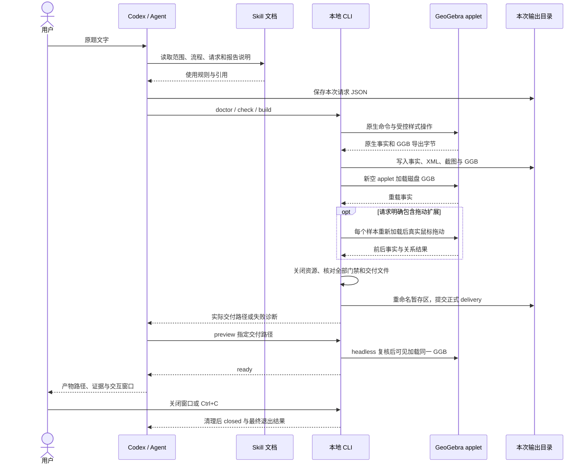

# 三角形案例执行走读：从 Codex、Skill 到 CLI 与 preview

本文沿一个具体请求解释当前工程的执行链路，面向希望对照设计和实现的同事。
阅读基线为提交 `22fb098`。本文是教学走读，不新增接口或验收规则。
详细规范仍以[需求](requirements.md)、[架构](arch.md)和[CLI 契约](demo-contract.md)为准。

案例原文是：

> 作三角形 ABC，取 AB 的中点 M，连接 CM。将 M 和 CM 标红，显示点名。

贯穿全文的分工是：**Agent 理解并组织请求，Skill 指导使用流程，CLI 管理执行和
核验，GeoGebra 解释数学。preview 复核并展示同一份交付文件。**

## 1. 先分清本文走读与真实验收记录

本文描述可观察的输入、调用、产物和实现，不虚构一次 Codex 自动接入插件的日志。
当前独立 CLI 已有真实引擎证据；Skill 已编写并静态检查，宿主自动发现、双宿主调用、
独立安装和发布仍未验收。真实运行记录统一见 [acceptance.md](acceptance.md)。

本次原文没有要求拖动。仓库中相关请求有不同用途：

| 输入 | 与本文关系 | 阅读边界 |
| --- | --- | --- |
| 本文原文 | 本次要解释的用户要求 | 请求应保留原文；不能把演示坐标说成题目条件 |
| [triangle-static.json](../examples/triangle-static.json) | 无拖动的技术子案例，构造与外观接近本文 | source 是技术子案例说明，不是本次原文；不能冒充本题专用请求 |
| [triangle.json](../examples/triangle.json) | 完整教学案例，增加真实拖动 A 的要求 | 第 10 节单独解释扩展；不能删掉这个文件的拖动要求后声称完整案例通过 |
| [triangle-counterexample.json](../examples/triangle-counterexample.json) | 静态中点反例 | 预期失败，用于解释依赖核验 |

仓库目前没有“原样保存本次原文且不含拖动”的专用请求文件。本文不创建新请求、
不运行新构图，也不生成新交付。文中的字段节选用于解释；实际运行时，Agent 应另存
本次请求，保留上述原文，不能改写已有案例或历史结果。

## 2. 怎样边读边跳转

| 想查的问题 | 权威文档 | 首先打开的实现 |
| --- | --- | --- |
| 为什么这样划分责任 | [架构](arch.md#架构与责任) | [CLI 入口](../src/cli.ts#L1) |
| Agent 应怎样使用工具 | [Skill 正文](../skills/ggb-demo-construction/SKILL.md#workflow) | Skill 是说明文件，没有对应的数学执行函数 |
| 请求允许什么 | [请求契约](demo-contract.md#请求-schema-与引用) | [schema](../schemas/request.schema.json)、[parseRequest](../src/request.ts#L115) |
| 怎样构造、导出、重载 | [交付流程](demo-contract.md#构图与交付文件) | [runTool](../src/pipeline.ts#L41)、[页面桥接](../viewer/engine.js#L113) |
| 怎样决定通过 | [检查条件](demo-contract.md#检查与通过条件) | [verifyRequest](../src/verify.ts#L150)、[readDelivery](../src/delivery.ts#L107) |
| 怎样预览和退出 | [preview 契约](demo-contract.md#preview-的完整性与生命周期) | [preview](../src/preview.ts#L14) |

代码链接附 `#L` 行号，函数名可用于编辑器内搜索。行号对应上述阅读基线；后续代码
变化时，以实际函数为准。此处只链接设计来源，不复制整份规范。

## 3. 先看整条调用链

下面是本案例的调用时序；Agent 部分表示约定的使用流程，CLI 部分对应现有代码。
组件边界和完整失败流程见[架构文档](arch.md#主要流程)。



图中的“提交”有前置条件：任一必需条件失败或资源关闭失败，CLI 都不会返回成功
交付路径。输入预检失败可直接退出，不启动浏览器，也不保证已有执行诊断目录。

## 4. 阶段一：Codex 接收题目，Skill 提供操作约束

**触发与输入。** 用户给出原文，Agent 取得 Skill 内容及其引用。模型推理沿用宿主，
本工程没有模型客户端、额外模型服务或模型 API Key 配置。

**实际动作。** Skill 的 frontmatter 描述名称和适用范围；正文规定提取条件、定位
CLI、预检、构建、读报告和预览的顺序。Agent 按这些说明组织后续调用。
当前不能把“说明文件存在”写成“Codex 已自动发现并执行了插件”。

**输出。** Agent 应形成以下可审查的任务理解，再编写请求：

| 原文内容 | 需要表达的构图或外观 | 本案例如何检查 |
| --- | --- | --- |
| 三角形 ABC | 三个点及由它们生成的三角形 | 对象存在、已定义、原生类型与非退化布尔检查 |
| AB 的中点 M | M 由 A、B 决定 | 原生父对象与中点关系 |
| 连接 CM | 端点为 C、M 的线段 | 原生 segment 类型及父对象 |
| M 和 CM 标红 | 两个对象颜色为红色 | 读取实际颜色，而非只看截图 |
| 显示点名 | 此例按 A、B、C、M 显示名称处理 | labelVisible 和名称模式 |

“显示点名”在此解释为点 A、B、C、M 的名称，并不自动要求给线段 CM 显示标签。
如用户另有标签要求，应在请求中明确。

**设计对照。** Skill 负责使用流程；它不运行数学，也不能写一句“验证通过”来
替代工具证据。正文保持通用，具体三角形配方放入案例文件，避免形成题型关键词路由。

跳转：[Skill 适用范围](../skills/ggb-demo-construction/SKILL.md#scope)、
[条件提取步骤](../skills/ggb-demo-construction/SKILL.md#1-extract-conditions-and-choices)、
[请求编写说明](../skills/ggb-demo-construction/references/request-and-cli.md)。
仓库 [AGENTS.md](../AGENTS.md) 约束开发和 Review；它与给作图 Agent 使用的 Skill
承担不同职责。

## 5. 阶段二：Agent 把题目组织成请求文件

**输入。** 原题、已列出的要求，以及为展示选定的初始构型。

**动作。** Agent 将原文写入 source，将选择写入 choices。此例可选择
A=(0,0)、B=(6,0)、C=(2,4)，它们不是用户给定条件。view 只控制可视范围。

下面是本题请求的字段节选，不是完整可执行 JSON：

```json
{
  "schemaVersion": 2,
  "source": "作三角形 ABC，取 AB 的中点 M，连接 CM。将 M 和 CM 标红，显示点名。",
  "choices": [
    "初始坐标 A=(0,0)、B=(6,0)、C=(2,4) 是演示选择，不是题目条件。"
  ],
  "interactions": []
}
```

本题原文没有拖动要求，因此上述范围下可以声明空 interactions。这个选择不适用于
仓库已有的完整教学请求；后者明确要求拖动，不能省略。

其余字段应按以下对应关系编写，完整形状以[契约](demo-contract.md#请求-schema-与引用)
和 [Request 类型](../src/request.ts#L38)为准：

| 请求部分 | 本案例的内容 | 为什么保留 |
| --- | --- | --- |
| requirements | geometry、appearance 两类要求，并写清描述 | 将原文要求关联到后续证据 |
| program | A、B、C、tri、M、CM 的原生表达式 | 保存实际执行程序，不只保存自然语言 |
| outputs | A、B、C、tri、M、CM | 明确哪些对象必须交付 |
| checks | 点、三角形、中点、线段与布尔关系检查 | 给出可执行验收声明 |
| styles | M、CM 为红色；A、B、C、M 显示名称 | 将外观要求纳入检查 |

Agent 在 program 中保存 label 与 expression 两个字段。例如 M 的 expression 为
`Midpoint(A,B)`，不写完整的 `M=Midpoint(A,B)`。赋值由可信桥接统一拼接，
表达式不能夹带第二条赋值或用户脚本。

构造与检查是两份相关声明。例如：

```json
{
  "id": "midpoint",
  "requirement": "geometry",
  "kind": "object",
  "label": "M",
  "type": "point",
  "parents": ["A", "B"],
  "coordinates": [3, 0]
}
```

这个对象检查核对类型、依赖和初始位置；另一个 boolean 检查使用
`AreEqual(M,Midpoint(A,B))`，由引擎解释中点关系。检查不能从截图反推。

**输出与边界。** Agent 把完整 JSON 保存为本次请求文件；CLI 本身不会从中文生成
这个文件。原文到清单是否完整仍需独立复核，结构覆盖不能证明语义提取没有遗漏。
实际字段可对照[已有无拖动技术请求](../examples/triangle-static.json)，不要覆盖它。

## 6. 阶段三：定位 CLI，先确认运行时，再做输入预检

### 6.1 安装根与 workspace 是两个位置

Agent 按[安装定位规则](../skills/ggb-demo-construction/references/installation.md#resolve-once-for-either-layout)
定位所选 CLI。安装根提供编译模块、schema、viewer、固定运行时及依赖；用户
workspace 保存请求和 output。显式 GGB_CLI 应保留，不重新指向其他副本。

代码中的[安装根和 outputRoot](../src/cli.ts#L13)体现了这条边界：前者按 CLI 模块
位置定位，后者使用调用方 cwd/output。请求路径和交付路径相对调用目录解释。
缺少资源时不得扫描样板仓库或其他客户端缓存补齐。

### 6.2 doctor 确认真实就绪

**触发与输入。** 按 Skill 工作流，在构图前检查安装身份和运行时。

**动作。** [runtimeIdentity](../src/runtime.ts#L15) 读取锁文件和 receipt，重新计算
本工程压缩包摘要，并记录许可摘要。[固定运行时锁文件](../runtime.lock.json)保存版本、
官方来源、SHA-256 和许可入口。当前解压目录尚未逐文件审计。

[doctor 分支](../src/pipeline.ts#L118) 真正加载 applet，执行
`DoctorPoint=(1,2)`，再检查点类型与坐标，最后关闭资源。大写标签有意保留：
本工程已观察到小写坐标标签可能被原生引擎解释为向量。

**输出。** doctor 返回 runtime-readiness 范围的证据路径与清理结果。它证明运行时
可执行，不证明三角形满足要求，也不证明宿主安装验收完成。

### 6.3 check 只检查输入

**触发与输入。** Agent 将本次请求路径传给 `check --request`。

**动作。** [CLI 参数解析](../src/cli.ts#L35)拒绝缺失、多余和不合规参数。
[readRequest](../src/request.ts#L226)检查文件容量、读取并解析 JSON；
[parseRequest](../src/request.ts#L115)用 schema 检查结构，再检查标签顺序、引用、
唯一性、输出与对象检查、requirement 覆盖，以及样式和交互引用。

[expression](../src/request.ts#L79)还限制词法与副作用：用户 JavaScript、字符串、
URL、额外赋值和受限命令不能作为执行入口。调用名仍交给原生引擎解释，这不是
枚举三角形、圆等题型的数学白名单。未知原生命令可能预检通过，再在引擎阶段失败。

**输出。** 成功结果标记 `scope=input-validation-only` 和
`mathematicalValidity=not-evaluated`。check 不启动浏览器；Agent 不能据此宣布作图通过。
详见[预检分派](../src/cli.ts#L73)和[CLI 输出契约](demo-contract.md#命令与输出)。

### 6.4 check、verifyChecks 与 build 的“通过”不是同一层级

下面按调用层级对照当前实现。检查规则的权威定义见
[检查与通过条件](demo-contract.md#检查与通过条件)，完整交付规则见
[构图与交付文件](demo-contract.md#构图与交付文件)。

| 层级与入口 | 输入与通过条件 | 可以得出的结论 | 不能得出的结论 |
| --- | --- | --- | --- |
| CLI 的 `check` | 请求文件通过参数、读取、schema、引用、容量、覆盖和副作用预检；退出 0 | 请求符合当前输入规则，可以尝试执行 | 引擎命令一定有效、数学关系成立，或已经有交付 |
| 内部函数 `verifyChecks` | 对当前 facts 中选定的 object／boolean 检查，逐项返回 passed | 这批事实满足本次实际检查的对象与布尔声明 | 颜色、点名、全部对象、重载、拖动和资源关闭都通过 |
| 内部函数 `verifyRequest` | 当前全部对象存在且已定义、类型受支持；verifyChecks 与 verifyStyles 全部通过，返回 ok=true | 当前这一个阶段的对象、布尔条件和样式核验通过 | 整条 build 管线已结束，或者文件已正式交付 |
| CLI 的 `build` | 预检、真实执行、初态与独立重载、内容比较、适用交互、要求汇总、资源关闭、文件校验和目录提交全部通过；退出 0 并返回成功 delivery 路径 | 本请求声明范围内的正式交付完成 | 原文提取必然完整、一般数学证明成立，或 preview 已成功结束 |

`verifyChecks` 是内部函数，不是另一个 CLI 命令。它返回逐项结果数组，不返回一个
总的成功布尔值。所谓“verifyChecks 通过”，是指当前执行到的每项 status 都为 passed。
如果调用方指定 ids，只检查对应子集；如果指定 stripCoordinates，便不再核对初态
固定坐标。不能把子集或去坐标后的通过扩大为完整请求通过。

对象检查始终要求存在且已定义；type、parents、coordinates 只有声明后才按对应
规则核对。布尔检查要求原生 boolean 且真值为 1。
这些细节见 [verifyChecks](../src/verify.ts#L63)；样式和全量对象门禁位于
[verifyRequest](../src/verify.ts#L150)，不属于 verifyChecks 本身。

用本案例可以区分三个容易混淆的时点：

- 将 M 构造为静态 `(3,0)`，输入仍可能通过 check；当请求声明 parents=[A,B] 时，
  verifyChecks 会发现依赖不符。
- M、CM 的关系正确，但颜色不是红色，verifyChecks 仍可能全通过；外观由
  [verifyStyles](../src/verify.ts#L129)判失败，当前阶段 verifyRequest 就不会通过。
- 初态对象、布尔关系和样式都正确，但导出失败或资源关闭失败，build 仍必须失败。
  初态报告中的 passed 不能变成正式交付成功。

本题没有拖动要求时，build 可以对声明的无拖动范围交付，但不能声称验证了拖动。
完整教学请求包含拖动时，必须执行且通过对应真实鼠标样本。
最终对外声明的时点见[第 11.1 节](#111-什么时候才能宣称交付成功)。

## 7. 阶段四：build 创建专用执行环境

**触发与输入。** Agent 调用 `build --request`。build 再次走相同请求预检，
不会把上次 check 的成功当作缓存凭据。

**动作。** [runTool](../src/pipeline.ts#L41)先创建本次独立暂存目录，保存请求并核对
能力、运行时和许可，然后分配服务与浏览器资源。暂存目录即使已有 GGB，也不属于
正式成功交付。

[EngineSession.launch](../src/browser.ts#L70)启动回环服务和专用 headless Chrome，
不附着到用户已有浏览器。[startServer](../src/server.ts#L10)只服务固定 viewer 和
realpath 限定的本地运行时资源；浏览器路由仅允许本次同源 GET，阻止其他请求、
WebSocket、service worker 和下载。

[freshApplet](../src/browser.ts#L83)创建新页面与上下文，等待原生 appletOnLoad
令 ready 成立，再确认对象数为 0。HTML 加载完成并不等于数学引擎就绪。

**输出与设计。** 得到本次独占的空 applet、环境记录和初始截图。
服务端文件边界与浏览器请求限制是两层控制；请求数据不能把 viewer 变成任意网页
执行器。原生数学留在 GeoGebra 内，浏览器 API 只由可信桥接调用。

跳转：[浏览器限制](../src/browser.ts#L108)、[applet 初始化](../viewer/engine.js#L5)、
[engine.html](../viewer/engine.html)。

## 8. 阶段五：GeoGebra 执行原生构造、布尔探针与样式

**输入。** 预检后的 Request，以及已经就绪的空 applet。

**动作。** [EngineSession.run](../src/browser.ts#L138)把请求作为数据传入固定页面。
[window.runRequest](../viewer/engine.js#L113)按 program 顺序调用 evalCommand，
检查主标签没有覆盖旧对象、命令返回成功且对象实际存在。

本案例在引擎端形成以下原生程序。它用于解释执行内容，不是供请求任意注入的脚本：

```text
A=(0,0)
B=(6,0)
C=(2,4)
tri=Polygon(A,B,C)
M=Midpoint(A,B)
CM=Segment(C,M)
```

随后桥接为 boolean 检查创建保留前缀 `ggbCheck` 探针。此例 checks 第 7、8 项
对应索引 6、7，因此生成 `ggbCheck6` 与 `ggbCheck7`，分别检查中点关系和
`Area(tri)>0`。核验器使用完整检查数组的索引读取它们，不单独重排 boolean 检查。

样式通过固定 API 应用：setColor 设置 M、CM 为红色；setLabelVisible 设置四个点
可见名称；setLabelStyle 使用名称模式。工具不因此向请求开放任意 Set* 命令。
最后设置 view，并切到仅绘图区，避免截图显示内部代数探针。

**输出与设计。** 引擎内存在真实对象和依赖，探针会随 GGB 保存。
隐藏探针显示不等于删除核验内容。新增题目应改变请求，不能在页面桥接里增加
“检测到三角形就执行一段配方”的分支。

跳转：[完整请求中的构造与检查](../examples/triangle.json)、
[样式与探针执行](../viewer/engine.js#L127)。

## 9. 阶段六：采集原生事实，决定初态是否通过

**输入。** 已构造的 applet，而不是模型描述或截图识别结果。

**动作。** [window.snapshot](../viewer/engine.js#L31)读取全部对象，包括原生命令
自动生成的边和探针。类型、定义状态、独立性、坐标、颜色、标签模式来自引擎 API；
parents 来自 getAlgorithmXML 的算法输入，不能由当前坐标推测。

管线的 [capture](../src/pipeline.ts#L67)保存事实 JSON、原始 XML 和真实截图，
再检查实际引擎版本。[verifyRequest](../src/verify.ts#L150)消费这些事实，
而不是让模型写入通过结论。

| 本案例检查 | 核验器实际核对什么 | 防止什么错误 |
| --- | --- | --- |
| A、B、C | 存在、已定义、point、独立性和所选初始坐标 | 未定义对象或错误类型 |
| tri | 本案例期望原生 API 类型 triangle，父对象为 A、B、C | 不能仅凭 Polygon 命令名推测 API 类型 |
| M | point、parents=[A,B]、非独立，初态坐标为 (3,0) | 静态 M=(3,0) 冒充依赖中点 |
| CM | segment、parents=[C,M] | 画了线段但端点或依赖不符 |
| midpointRelation | 原生 boolean、已定义、数值真值 1 | 模型 passed 或 numeric 的 1 冒充通过 |
| nondegenerate | 原生 Area(tri)>0 为真 | 退化的三点构型 |
| appearance | 实际颜色、labelVisible 与名称模式 | 样式命令写过，但最终显示属性不对 |

[verifyChecks](../src/verify.ts#L63)执行对象和布尔检查，
[verifyStyles](../src/verify.ts#L129)核对外观。所有实际对象还必须存在、已定义，
且类型在当前工具支持范围内；不能只检查声明输出而忽略坏对象。

**输出与设计。** initial 阶段报告将期望、实际事实、检查 id 与 requirement 关联。
任一失败会阻止后续正常交付。父对象检查提供本案例的依赖证据；它不等于对所有未来
拖动都做过实际操作。静态反例的历史结果见[验收记录](acceptance.md#v2-完整三角形与拖动)。

## 10. 阶段七：导出磁盘文件、独立重载；拖动是明确的扩展

### 10.1 导出与独立重载是主线的一部分

**触发与输入。** 初态检查和脚本审计通过，管线才继续导出。

**动作。** [导出分支](../src/pipeline.ts#L170)调用原生 getBase64，检查返回内容并
写为 construction.ggb，再由 [auditGgb](../src/delivery.ts#L46)检查 ZIP 内容、脚本
和外部资源边界。这里没有手工制作 GGB。

随后调用 freshApplet 关闭旧页面、旧上下文，验证新 applet 为空，再用 readFile
读取磁盘 construction.ggb，通过原生 setBase64 加载。它没有重新执行 program，
也没有复用原 applet 中的对象来冒充文件可重载。

重载后再次执行相同请求检查。[compareReload](../src/verify.ts#L170)比较稳定对象
字段、依赖、样式、命令、值和脚本；不是比较截图像不像。

**输出。** reloaded 报告、内容比较结果、重载事实、XML 和截图。
最终 preview.png 复制自真实 reloaded.png。

跳转：[磁盘重载实现](../src/pipeline.ts#L182)、
[原生导出与加载桥接](../viewer/engine.js#L86)。

### 10.2 对仓库完整教学案例，继续逐样本真实拖动

本次原文没有拖动要求。对于本题对应的空 interactions 请求，管线不执行鼠标样本，
报告标记 `mouseInteraction=not-requested`。这不是拖动验证通过。

仓库 [triangle.json](../examples/triangle.json) 则明确要求：A 从 (0,0) 拖到 (-1,1)，
继续核对中点关系与 CM 依赖。该扩展中的每个样本都执行以下过程：

1. 关闭前一上下文，验证新 applet 为空。
2. 再次读取同一磁盘 GGB，核对摘要与加载内容。
3. 记录拖动前事实、视口、可见性与附近候选点。
4. 将世界坐标换算为画布像素，用真实 mouse.down、move、up 操作。
5. 保存拖动后事实、XML、截图，检查实际位移、目标误差、依赖、不变量和样式。

此例拖动后，M 预期随 AB 联动到 (2.5,0.5)，CM 继续连接 C 与 M。
交互核验剥离初态固定坐标期望，保留依赖与布尔不变量，并检查其他独立点没有被误移。
命中歧义、未移动、未松开鼠标或缺少证据都不能记为样本通过。

跳转：[样本独立加载](../src/pipeline.ts#L217)、
[真实鼠标实现](../src/browser.ts#L188)、[evaluateDrag](../src/interaction.ts#L224)。
固定坐标和鼠标像素容差以[契约](demo-contract.md#请求-schema-与引用)为准，不由 Agent 放宽。

## 11. 阶段八：汇总、关闭资源，再提交正式 delivery

**输入。** initial、reloaded、内容比较，以及请求适用的交互报告。

**动作。** [summarizeRequirements](../src/verify.ts#L229)把阶段检查、样式和交互
映射回每条要求；缺证据则未验证。管线据此写 verification.json。

接着，管线在 [finally](../src/pipeline.ts#L388) 调用
[EngineSession.close](../src/browser.ts#L210)，逐项关闭页面、上下文、浏览器和服务。
单个关闭失败不会跳过其他资源；关闭结果写入 cleanup.json。

只有前面没有错误、所有清理通过，才进入[提交阶段](../src/pipeline.ts#L414)：

1. 为暂存目录中的文件计算摘要，最后写 manifest.json，避免清单包含自己的摘要。
2. 用消费者同样的 readDelivery 核对完整交付。
3. 分配独占 delivery 父目录，将暂存目录重命名为其中的新子目录。
4. 返回本次实际 delivery 绝对路径。

[readDelivery](../src/delivery.ts#L107)检查必需文件、文件名、普通文件和软链接边界、
逐项摘要、请求身份、清理结果，并从原始事实重算报告。它还审计 GGB，检查 PNG
签名；有交互时重算每个样本和 requirements。删除必需文件并同步清单也会被拒绝。

**输出与设计。** GGB、请求、核验报告、截图、身份、许可和阶段证据属于同一次交付。
清单摘要用于内容一致性，不是来源签名。正式路径不按标题复用，不覆盖同名旧结果。
输出文件全集和容量只在[交付契约](demo-contract.md#构图与交付文件)维护。

出现资源关闭失败或提交失败，CLI 非零退出，不返回成功路径。失败目录中即使已经
存在 GGB，也只能解释为诊断或暂存材料。

### 11.1 什么时候才能宣称交付成功

**工具层面的成功信号，是本次 build 正常结束、退出码为 0，并在成功业务 JSON 中
返回实际正式 delivery 路径。** 该路径是在完整校验与重命名提交之后返回的，
不是尚在执行的暂存区。对应代码见[提交与返回](../src/pipeline.ts#L439)和
[CLI 成功响应](../src/cli.ts#L87)。

不能只凭 verification.json 中的 status=passed 宣称交付成功：管线可能先写入阶段
或汇总报告，随后才清理资源、校验清单并提交目录。这些后续步骤仍可能失败。
同样，截图、一个已导出的 GGB、单次 verifyChecks 或 verifyRequest 通过，都不代表
build 最终成功。

Agent 对用户声明完成前，还要按[报告阅读流程](#12-阶段九agent-读结果再调用-preview)
对照原文与本次 request、核验报告，确认所有用户要求都已声明并有通过证据。
如果原文条件被漏掉，即使 build 对剩余声明交付成功，也不能说原题全部完成。

推荐明确区分以下两种表述：

- **文件交付成功：** 本次 build 最终成功，返回真实 delivery，且已复核请求与
  报告覆盖用户要求。可以说明该声明范围内的 GGB、报告和截图已交付。
- **交互预览状态：** preview 的 ready 表示窗口就绪；closed、退出 0 和清理记录
  表示正常退出。预览未打开、失败或仍在运行时，应分别说明，不能把文件交付成功
  写成整条使用流程都已成功结束。

preview 是 Skill 的后续交互交接步骤，但不回写原 build 结果。预览失败应单独报告，
不改动已经提交的交付。无论上述哪一层通过，都不构成一般数学证明。

## 12. 阶段九：Agent 读结果，再调用 preview

**触发与输入。** build 返回成功业务 JSON，Agent 取得实际 delivery 路径。

**动作。** Agent 不能只看到 ok=true 就结束。按
[报告阅读说明](../skills/ggb-demo-construction/references/report-reading.md)，核对
原文与 request、initial、reloaded、requirements、适用交互、cleanup 和请求日志。
尤其要确认报告覆盖用户条件，而不是只覆盖一个被简化的请求。

CLI 的成功业务响应在 stdout，失败 JSON 在 stderr 并非零退出。Agent 应读取
error.code 和 diagnostics，不按人类可读 message 做路由。
详见[CLI 输出](../src/cli.ts#L87)和[错误契约](demo-contract.md#超时错误与限制)。

然后，Agent 按 Skill 调用 `preview --delivery`，传入刚才返回的实际路径。
preview 不接受一段新构图程序来替代交付文件。

### 12.1 预览先完整性复核，再加载同一文件

[preview](../src/preview.ts#L14)首先用 readDelivery 核对目录，取得已核对摘要的
GGB 字节，并验证安装运行时与交付记录匹配。

它先创建专用 headless 会话，空 applet 加载相同字节，重新检查请求条件并与保存的
reloaded 事实比较。关闭验证资源后，另建可见会话，再加载相同字节并检查。
两个阶段都不调用 runRequest 重画。

这里的预览复核不重新执行全部鼠标样本：既有交互证据由 readDelivery 重算，
新 applet 复核加载后的对象条件。用户在窗口内手动拖动不替代 build 的自动交互证据。

跳转：[loadAndVerify](../src/preview.ts#L84)、[两阶段会话](../src/preview.ts#L110)。

### 12.2 ready、closed 与退出码分别表示什么

| 时点 | 返回或动作 | Agent 应怎样解释 |
| --- | --- | --- |
| 可见窗口完成加载和检查 | `result.event=ready` | 用户可以交互；进程仍运行，资源尚未退出 |
| 用户关闭窗口或发送 Ctrl+C | preview 收到关闭事件或信号 | 开始结束展示并进入清理 |
| 清理完成且没有失败 | `result.event=closed`，进程退出 0 | 正常退出；还可对照独立预览诊断中的 cleanup |
| 就绪前取消或任何阶段失败 | 非零退出，结构化错误 | 不把 ready 当最终成功；保留原交付，单独报告预览失败 |

preview 拥有自己的 SIGINT、SIGTERM、SIGHUP 处理，并禁用 Playwright 的默认信号
退出，避免绕过 finally。它不修改原交付；窗口内拖动只改变内存，不自动保存 GGB。

跳转：[ready 与 closed](../src/preview.ts#L125)、[预览清理](../src/preview.ts#L150)。

**最终交给用户的内容。** Agent 报告实际交付目录及 GGB、verification.json、
preview.png、request.json、manifest.json 等主要产物，并说明声明范围和预览状态。
不能在预览仍打开时说所有资源已退出，也不能把未验证的宿主安装写成已经完成。

## 13. 沿失败路径反查设计

| 观察到的失败 | 首先查看 | 对应设计 |
| --- | --- | --- |
| 请求有未知字段、漏声明或坏引用 | request.ts、schema、stderr 的 INPUT_INVALID | 模型输出是不可信输入；在引擎前拒绝 |
| command 合法但原生构造失败 | failure.json 的 stage、请求和浏览器日志 | 词法预检不替代引擎解析 |
| 静态 M=(3,0) 被拒绝 | midpoint 实际 parents、independent | 正确数值不能冒充动态依赖 |
| 原生条件失败、重载内容不同 | verification.json、两阶段事实和 XML | 截图相似不能替代对象和文件一致性 |
| 请求含拖动但样本失败 | 交互报告、前后事实与截图 | 不用 API 改坐标替代真实鼠标，也不静默跳过 |
| 正式目录缺必需文件 | readDelivery、manifest、PREVIEW_ERROR | 摘要列表不能自行缩小完整交付要求 |
| 关闭资源或提交失败 | cleanup.json、diagnostics、CLI 错误码 | 清理与提交都是成功门禁 |
| build 成功但 preview 失败 | 独立 output/preview 诊断 | 预览单独报告，原交付保持不变 |

请求或文件读取阶段可能没有执行诊断目录。执行阶段则尽量保存首个失败、请求、事实
和可取得的截图。Agent 按[Skill 失败规则](../skills/ggb-demo-construction/SKILL.md#failure-and-repair-limit)
保留旧证据，自动修复最多两次，每次另存请求并新开运行；不得删条件或放宽容差。
宿主分析、LLM 修改与新 CLI 运行之间的边界，见[架构中的失败修复流程](arch.md#agent-接收失败后的修复流程)。

build 的完整信号取消协议与端到端超时清理仍未验收；不能由正常成功或 preview
退出推导所有取消路径均可靠。A11 的部分验证状态见[需求](requirements.md#逐条可观察的验收条件)。

## 14. 同事怎样按顺序对照代码

| 阅读顺序 | 定位点 | 要回答的问题 |
| --- | --- | --- |
| 1 | [Skill](../skills/ggb-demo-construction/SKILL.md) 与 [安装定位](../skills/ggb-demo-construction/references/installation.md) | Agent 根据什么规则操作，选中哪个 CLI？ |
| 2 | [静态技术请求](../examples/triangle-static.json) 与 [完整教学请求](../examples/triangle.json) | 本题条件、演示选择与拖动扩展怎样区分？ |
| 3 | [cli.ts](../src/cli.ts)、[request.ts](../src/request.ts) | JSON 在哪里被拒绝，为什么 check 不代表数学通过？ |
| 4 | [pipeline.ts](../src/pipeline.ts)、[browser.ts](../src/browser.ts)、[engine.js](../viewer/engine.js) | 谁拥有资源，谁执行原生命令，谁写磁盘？ |
| 5 | [verify.ts](../src/verify.ts)、[interaction.ts](../src/interaction.ts) | 事实从哪来，哪些条件决定失败？ |
| 6 | [delivery.ts](../src/delivery.ts)、[preview.ts](../src/preview.ts) | 何时算正式交付，预览是否仍是同一份 GGB？ |
| 7 | [集成测试](../tests/integration.test.ts) 与 [验收记录](acceptance.md) | 哪些设计已有真实引擎证据，哪些仍未验证？ |

如果要复现，环境与构建入口使用 [README](../README.md#环境与安装)，命令使用
[CLI 契约](demo-contract.md#命令与输出)。两个现有案例都可先执行只读输入预检：

```sh
node dist/src/cli.js check --request examples/triangle-static.json
node dist/src/cli.js check --request examples/triangle.json
```

需要构建或预览时，按选定请求范围运行契约中的命令，并使用本次返回路径。
本文不附旧成功路径作为默认值，也不要求为阅读文档重跑已有充分证据的真实实验。

本文应用清晰技术写作原则。时序图保留 Mermaid 图源，未做渲染验收。
总结录屏仍可从[三分钟提纲](summary-video.md)进入；本文提供其背后的详细对照。
