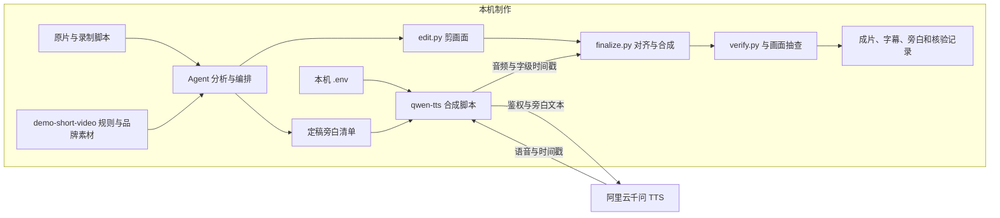
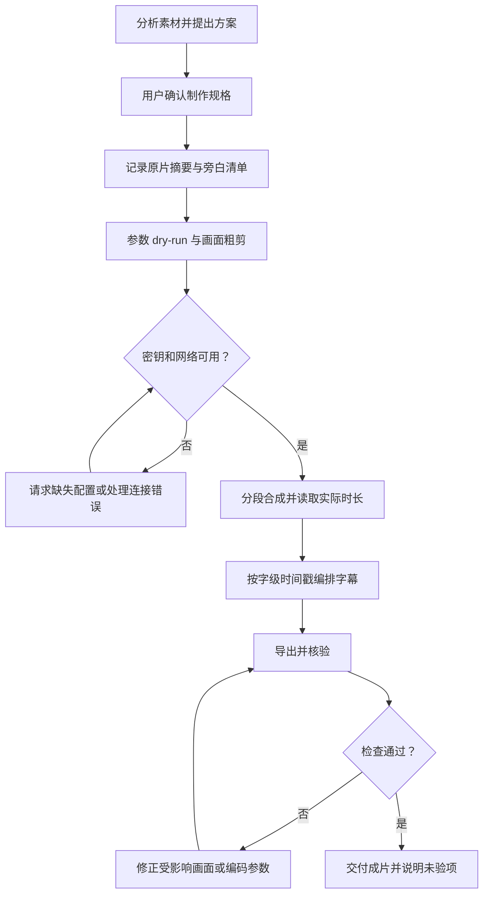
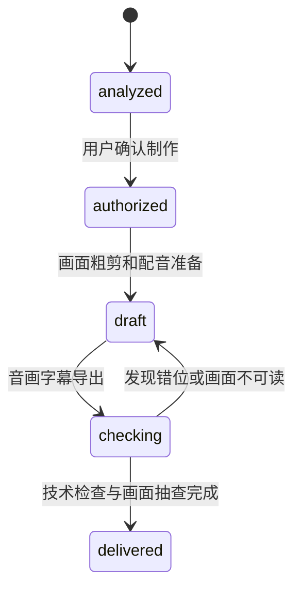

# 第 02 段录屏剪辑复盘与同事复现指南

本次将约 10 分 15 秒的开发录屏剪成约 2 分钟的教学视频，使用千问安明远 AI 配音和中文字幕。生成等待采用跳切，关键文档留出阅读时间。原片只读保留，成片另存。

本文面向准备制作开发教学视频的同事，记录 2026-10-30 本次实际执行的方法、产物和限制。本文不改变插件需求与验收契约。录制内容依据 [录制脚本第 02 段](recording-script.md#5-第-02-段-从需求与验收开始)。录屏展示的是当时的需求阶段，不能用当前仓库的实现状态替代当时画面。

## 1. 从讨论到确认的需求

第一次请求提供了原始录屏和录制脚本，要求分析第 02 段的剪辑方式，压缩大量等待，并考虑字幕及 TTS。原话中的“补充字母”按“补充字幕”理解，后续明确要求“加中文字幕”。

第一次讨论只分析素材，没有合成配音或导出视频。分析完成后，用户明确授权开始制作。

| 讨论事项 | 最终决定 | 对制作的影响 |
| --- | --- | --- |
| 章节目标 | 从需求与验收开始 | 重点展示完成条件、职责、范围和失败门禁 |
| 时长 | 约 2 分钟 | 以脚本的章节预算组织镜头 |
| 等待 | 跳切压缩 | 显示“等待已压缩”，保留真实完成结果 |
| 配音 | 千问安明远 | 固定音色，不更换供应商 |
| 字幕 | 简体中文 | 烧录进视频，并交付可编辑 SRT |
| 原始素材 | 完整保留 | 原片只读，制作前后核对 SHA-256 |
| 输出位置 | 独立版本目录 | 使用 `output/02-edit-v1/` |
| 版式 | 1080p 横屏，正文局部放大 | 不拉伸原录屏，字幕使用独立安全区 |

### 可复用的需求沟通方法

先明确“观众看完要知道什么”，再讨论转场和倍速。本章需要让观众理解：开发前先写清输入、输出、可观察验收条件和失败门禁。

第一次分析应回答四个问题：

1. 原片中有哪些真实操作和结果？
2. 哪些部分可以删除，哪些部分需要阅读时间？
3. 脚本与实录有哪些差异，需要怎样解释？
4. 最终交付的时长、声音、字幕、文件位置和原片保护要求是什么？

本次识别出一个需要保留的差异：三角形贯穿案例在后段补充明确。成片因此安排“最后，把首轮案例补充具体”，没有把全部要求剪成一开始就已完整输入。

## 2. 素材分析和取舍

源文件为 [`output/02-从需求与验收开始.mov`](../output/02-从需求与验收开始.mov)。实际检查结果为：

| 项目 | 原片 |
| --- | --- |
| 容器时长 | 615.183334 秒 |
| 分辨率 | 3024 × 1964 |
| 视频编码 | H.264，变帧率；平均约 37 fps |
| 音轨 | AAC，48 kHz，双声道 |
| 文件大小 | 333,697,225 字节 |

不要将视频流报告的 `240/1` 直接当成恒定帧率。帧数、平均帧率和时间戳需要结合判断。

分析时先用 `ffprobe` 读取参数，再用 FFmpeg 每约 20 秒抽帧生成联系表。联系表用于定位，不能直接作为精确剪辑点。关键位置另用 `-ss` 抽帧确认，尤其检查停止、重提、文档结果、案例补充和提交结果。

原片前半段包含提示词编辑、一次停止后重新提交，以及生成等待；后半段包含文档阅读、案例补充和提交结果。剪辑保留输入、真实结果和需求确认，删去重复编辑及长等待。

原声未混入成片。成片使用新生成的教学旁白。已检测到原片音轨，但没有完成原声试听，不能断言原声只有噪音。

## 3. 最终时间线

下表是最终镜头安排。源区间与裁剪参数由 [`edit.py`](../output/02-edit-v1/edit.py) 定义；带配音与字幕时间的完整记录见 [`timeline.json`](../output/02-edit-v1/timeline.json)。

| 成片区间 | 内容 | 使用的源区间 | 处理 |
| --- | --- | --- | --- |
| 00:00–00:04 | 本章片头 | 新制作标题卡 | 显示章节主题 |
| 00:04–00:14 | 初始工程 | 00:05–00:12 | 正常速度，尾帧停留 |
| 00:14–00:28 | 提示词与重新提交 | 04:13–04:25 | 正常速度，标注提示词调整 |
| 00:28–00:32 | 生成完成 | 06:28–06:32 | 跳过中间等待，明确标注压缩 |
| 00:32–00:46 | 输入与交付物 | 07:27–07:34 | 放大文档，尾帧停留 |
| 00:46–00:58 | 职责与边界 | 07:08–07:16 | 放大文档，尾帧停留 |
| 00:58–01:16 | 可观察验收条件 | 07:52–08:02 | 放大表格，留阅读时间 |
| 01:16–01:29 | 失败门禁与独立安装 | 08:37–08:43 | 放大关键段落，尾帧停留 |
| 01:29–01:46 | 三角形案例补充 | 10:05 起约 0.1 秒 | 使用实录画面定格阅读 |
| 01:46–01:56 | 确认与提交结果 | 10:05 起约 0.1 秒 | 同一时刻的另一裁剪区域，定格阅读 |
| 01:56–02:00 | 下一段过渡 | 新制作独立封底 | 保持到最后一帧 |

文档镜头按教学顺序重排：“输入与交付物”先于“职责与边界”，两段的源时间并非递增。它们用于讲解同一阶段的文档，不表示重新发生了一次操作。涉及停止、重提及后段补充要求的因果关系保持可解释。

等待采用跳切，保留的操作片段为正常速度。定格用于阅读，不表示鼠标在持续操作。本次没有补录操作、伪造打字或创建新的 GGB 演示。

## 4. 实际制作流程和责任

### 组件与数据边界



`demo-short-video` 提供制作规则、参考流程和品牌素材。`qwen-tts` 提供真实语音合成脚本。本次画面剪辑、字幕烧录和验证由输出目录中的三个 Python 脚本完成；没有调用视频 Skill 中的 `voiceover.py`。

本次 TTS 接口接收旁白文本，不接收原始录屏。密钥从用户配置的 `.env` 读取，没有写入命令参数、文档或交付物。

### 执行顺序



1. 创建独立输出目录，记录原片 SHA-256。
2. 将旁白整理为 10 段，共约 390 个字符，保存为 `tts-manifest.json`。
3. 用 `--dry-run` 检查所有合成参数，未读取密钥、未联网。
4. 准备画面粗剪。由于项目和环境起初没有密钥，请求用户配置 `.env`，同时继续不依赖密钥的工作。
5. 用户补充 `.env` 后发起合成。首次请求出现网络/TLS 错误，没有生成音频；保留失败记录。
6. 通过执行环境的联网权限路径重新发起请求，输出到新的 `audio-v2/`。10 段全部完成，没有重复请求已成功音段。
7. 测量真实音频时长，调整镜头时窗。结束旁白约 9.24 秒，原定 8 秒不足，因此将结束场景扩为 10 秒，并从提示词场景调出 2 秒。
8. 根据千问字级时间戳重新按语义断句，生成 40 条字幕。没有直接照搬自动 SRT 中跨词的断句。
9. 用 Pillow 生成中文标题、操作标注和字幕 PNG，再由 FFmpeg 叠加。当前 FFmpeg 构建未提供 `drawtext` 和 `subtitles` 滤镜。
10. 合成原生语速音轨，进行响度处理，输出 H.264/AAC MP4。
11. 检查解码、媒体参数、字幕边界、各场景画面、最后一帧和原片摘要。

### 素材状态与返修

以下状态用于说明本次制作门禁，不是实现了一个自动工作流系统。



| 状态迁移 | 条件 | 执行者与动作 |
| --- | --- | --- |
| analyzed → authorized | 用户明确要求开始剪辑 | 用户确认规格，Agent 开始制作 |
| authorized → draft | 输出目录和原片摘要已保存 | Agent 编排镜头、合成配音 |
| draft → checking | 音频可测、字幕有时间依据 | Agent 导出并检查 |
| checking → draft | 帧率错位或关键文字被滚动移出 | Agent 修正相关片段，不交付错误导出 |
| checking → delivered | 已完成实际记录的检查 | Agent 交付，并保留“未逐句试听”限制 |

仅分析阶段不进入制作。检查失败时不能以文件已生成作为交付依据。这里的 `delivered` 不表示人工听感验收完成。

## 5. 配音、字幕和编码契约

| 环节 | 输入 | 输出与约束 |
| --- | --- | --- |
| 千问合成 | 定稿文本、音色、语速、私有密钥 | 每段 WAV、字级时间戳、参数及报告；失败保留记录，不自动反复计费 |
| 画面剪辑 | 原片、源区间、裁剪区域、场景时长 | 正常速度片段与阅读定格；输出统一帧率及时间基 |
| 字幕对齐 | 定稿文本与实际 `words.json` | SRT 与烧录字幕；使用真实起止时间，不按字数均分总时长 |
| 音画合成 | 画面粗剪、字幕、独立音段 | 配音不能超出所属场景；不截断尾音，不做后期加速 |
| 验证 | 成片、时间线、原片摘要 | 核对规格、完整解码、字幕顺序、配音边界及原片不变 |

本次采用：

- 模型：`qwen-audio-3.1-tts-flash`。
- 音色：`anmingyuan_v3.1`，安明远。
- 原生语速：`rate=0.9`，没有后期 `atempo` 加速。
- 风格指令：普通话清楚自然，耐心亲切的技术教学口吻，停顿简洁，英文缩写准确。
- 10 段原生语音合计约 90.93 秒，其余时间用于片头、片尾、观察和阅读。
- 视频：1920 × 1080、30 fps、H.264、`yuv420p`。
- 音频：AAC、48 kHz、192 kbps；合成前的独立旁白为 24 kHz 单声道 WAV。
- 响度滤镜：`loudnorm=I=-16:TP=-1.5:LRA=11`。这是处理参数，不表示另做了成片响度测量。
- 容器启用 `+faststart`。

音色与接口在执行前核对了阿里云的[音色列表](https://help.aliyun.com/zh/model-studio/qwen-audio-tts-voice-list)和 [HTTP API 文档](https://help.aliyun.com/zh/model-studio/qwen-audio-tts-http-api)。后续模型、音色、地域与端点以届时文档和账户配置为准。

## 6. 本次发现的问题与修正

### 混用帧率导致拼接错位

首次导出中，片头和封底是 30 fps，部分录屏片段被 PNG 输入的默认帧率带成了 25 fps。对应 MP4 的时间基分别为 `1/15360` 和 `1/12800`。直接流复制拼接后，部分镜头与字幕、旁白错位。

修正时，将所有片段明确输出为 30 fps，并检查每段时间基统一为 `1/15360`，再重新拼接。错误导出没有交付，临时错误视频已删除。

这说明：各段时长相加正确、成片能够播放和完整解码，都不足以证明时间线正确。还必须在各场景起点抽查画面与旁白是否对应。

### 滚动导致关键案例移出画面

后段原片存在滚动。直接保留连续片段时，案例说明很快移出裁剪区域。最终选取源片 10:05 附近的真实画面，分别裁出案例确认和提交结果，并定格供阅读。

定格不补造新的操作证据。`timeline.json` 记录源区间、裁剪区域、正常速度和尾帧停留时长。

### 自动断句不一定适合中文字幕

接口附带的自动 SRT 出现过将“核验”拆到两条字幕的情况。最终按旁白的逗号、句号重新断句，再用实际字级时间戳确定每条字幕起止。最终保留 40 条字幕。

## 7. 交付与已验证范围

| 产物 | 位置 |
| --- | --- |
| 最终视频 | [02-从需求与验收开始-精剪.mp4](../output/02-edit-v1/02-从需求与验收开始-精剪.mp4) |
| 可编辑字幕 | [subtitles.srt](../output/02-edit-v1/subtitles.srt) |
| 旁白稿与独立音轨 | [narration.txt](../output/02-edit-v1/narration.txt)、[narration.wav](../output/02-edit-v1/narration.wav) |
| 合成清单与成功音段 | [tts-manifest.json](../output/02-edit-v1/tts-manifest.json)、`output/02-edit-v1/audio-v2/` |
| 最终时间线 | [timeline.json](../output/02-edit-v1/timeline.json) |
| 核验记录与联系表 | [verification.json](../output/02-edit-v1/verification.json)、[review-contact.jpg](../output/02-edit-v1/review-contact.jpg) |
| 本次制作脚本 | [edit.py](../output/02-edit-v1/edit.py)、[finalize.py](../output/02-edit-v1/finalize.py)、[verify.py](../output/02-edit-v1/verify.py) |

最终容器时长为 **120.017 秒**，大小为 **7,193,807 字节**。已完成完整解码、媒体参数检查、40 条字幕顺序和配音边界检查，以及各场景和最终封底的静态抽查。原片 SHA-256 制作前后一致。

未完成配音逐句试听，也没有全片实时播放听看验收。因此可以报告技术检查和关键画面抽查通过，不能报告人工听感验收通过。

上述 `output/` 产物不随源码提交。只转发本文或 Git 仓库时，这些链接可能不可用；分享时需要另外带上对应目录。

## 8. 同事需要打包哪些 Skill

### 制作必需的两个本机 Skill

| Skill | 本机位置 | 打包内容与用途 |
| --- | --- | --- |
| `demo-short-video` | `/Users/lijunqiang1/.codex/skills/demo-short-video/` | 整个目录；包括 SKILL.md、references、assets、scripts、agents 和 tests。提供制作规则、版式、品牌素材及参考脚本 |
| `qwen-tts` | `/Users/lijunqiang1/.codex/skills/qwen-tts/` | 整个目录；包括真实合成脚本、接口参考和测试 |

不要只打包两个 `SKILL.md`。它们引用的脚本、参考文件和头像素材同样需要随包提供。本次制作没有使用 GeoGebra 构造 Skill、OpenAI TTS 或新的图像生成服务。

本文编写另使用了 `ste-technical-docs`，本机位置为 `/Users/lijunqiang1/.agents/skills/ste-technical-docs/`。它只用于文档结构和文字检查，不是剪辑依赖；同事需要同样的文档工作方式时再打包。

下面的命令用于制作两个剪辑 Skill 的归档。**本次文档整理只提供命令，尚未执行打包或在同事电脑上安装。** 在仓库根目录执行：

```sh
skill_root='/Users/lijunqiang1/.codex/skills'
package_output="$PWD/output/video-skill-share"
mkdir -p "$package_output"
tar -czf "$package_output/video-editing-skills.tar.gz" \
  -C "$skill_root" demo-short-video qwen-tts
tar -tzf "$package_output/video-editing-skills.tar.gz"
shasum -a 256 "$package_output/video-editing-skills.tar.gz" \
  > "$package_output/video-editing-skills.tar.gz.sha256"
```

当前这两个目录的文件清单已检查，未包含 `.env`。将来打包前仍需查看清单。不要把仓库根目录、`.env`、凭据或无关配置整体打入分享包。头像与品牌素材是本次用户风格，同事需确认是否沿用。

同事应按其 Codex 环境的个人 Skill 安装方式放置两个完整目录，保留目录名；已有同名目录时先比较，不直接覆盖。本次没有验证另一台机器的安装或发现结果。

### 只看结果与完整复现的分享范围

- 只看结果：分享本文、最终 MP4、SRT 和旁白稿。
- 修改本片：另带原片、三个制作脚本、时间线、成功的 `audio-v2/` 和两个 Skill。
- 制作其他章节：分享两个 Skill 和本文的方法；重新分析新原片、写旁白和编排镜头，不套用本片时间码。

复用成功音段可以避免再次计费。首次网络失败保存在 `audio/`，成功结果在 `audio-v2/`；二者不能混淆。

## 9. 环境要求与复现步骤

本次实测环境为 macOS、Python 3.9.6、Pillow 11.3.0、FFmpeg/ffprobe 8.0.1。它们是本次环境记录，不是跨平台最低版本承诺。本次没有安装或修改全局依赖。

同事需要 Python、Pillow、FFmpeg 和 ffprobe。建议用独立 Python 环境准备依赖。中文字体必须可用；本次使用 `/System/Library/Fonts/Hiragino Sans GB.ttc`。

本次三个脚本是单片制作脚本，**尚未封装成可直接跨机器运行的工具**。复现前需要调整：

- `edit.py` 中的 `SOURCE`、`AVATAR`、字体路径和 `SCENES`。
- `finalize.py` 中的字体、成功音段目录、总时长相关断言及字幕排版。
- `verify.py` 中的总时长断言、联系表尺寸和临时输出目录；先创建该临时目录。
- 原片保持本次相对目录关系，或同步修改 `SOURCE`。运行脚本所需的旁白清单必须存在。

### 配音命令

以下为本次参数示例。替换占位路径后执行；输出目录必须是尚不存在的新目录。

```sh
qwen_skill='/absolute/path/to/qwen-tts'
work_dir='/absolute/path/to/new-edit'
key_file='/absolute/path/to/private/.env'
python3 "$qwen_skill/scripts/synthesize.py" \
  --manifest "$work_dir/tts-manifest.json" \
  --voice anmingyuan_v3.1 --rate 0.9 \
  --instruction '普通话清楚自然，耐心亲切的技术教学口吻，停顿简洁，英文缩写准确。' \
  --timestamps --output-dir "$work_dir/audio-v2" --dry-run
```

参数检查通过后，使用相同参数，去掉 `--dry-run`，增加 `--env-file "$key_file"`。按当前账户配置核对地域和端点；本次使用的是 Skill 默认的北京试用端点，不代表同事账户一定可以直接使用。

不要通过聊天发送密钥。不要把密钥填入命令行参数或分享包。网络或鉴权失败时先看 `results.json` 和对应 `report.json`，只处理失败或未执行条目，不重复合成成功条目。

### 画面、合成和验证

在新的制作目录准备文件，完成路径调整后，依次运行：

```sh
python3 "$work_dir/edit.py"
python3 "$work_dir/finalize.py"
python3 "$work_dir/verify.py"
```

`edit.py` 会复用已存在的片段。改过源区间、时长、裁剪或编码参数后，需清理新工作目录中受影响的缓存和旧拼接结果，再重新生成。各脚本默认不覆盖已有最终导出；返修时使用新的版本目录，或只清理本次生成且已确认需要重做的文件。不要对原始素材目录做批量清理。

最后人工检查关键输入、等待标注、字幕断句、文档可读性和封底，并试听整段配音。没有实际执行的检查应继续标为未验。

## 10. 给同事的可复用提示词

先分析：

```text
请对照章节脚本分析这段原始录屏，先不要制作。
检查时长、画幅、帧率和音轨，抽帧定位真实输入、关键操作和结果。
建议约两分钟的教学时间线，说明哪些等待跳切、哪些文字需要放大。
指出实录与脚本的差异，不补造缺少的操作或成功结果。
给出旁白主线、字幕方式、交付文件和待确认项。
```

确认后制作：

```text
按已讨论方案开始剪辑，控制在两分钟左右。
使用千问安明远 AI 配音和简体中文字幕，等待部分跳切并明确标注。
保留原片，新建独立版本目录。先测真实配音时长，再对齐镜头与字幕。
交付 MP4、可编辑 SRT、旁白稿、独立音轨、时间线和检查记录。
核对各段帧率与时间基、字幕边界、完整解码、首尾和原片摘要。
报告实际未完成的检查，不把静态抽帧称为完整听看验收。
```

本文已应用 STE 的清晰写作原则；未进行完整英语受控词典核对，不宣称 ASD-STE100 合规。文中的 Mermaid 图源做静态核对，未在本次文档任务中渲染验证。
